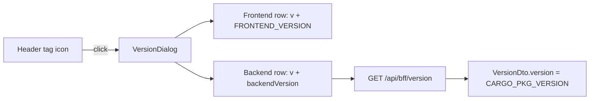

# 157 - Header version badge (frontend + backend tags)

Status: implemented

## Goal

Add a small tag icon to the shared top header. Clicking it opens a popup dialog
(same pattern as the existing global-summary dialog) that lists the currently
installed application versions:

- **Frontend** version, baked into the bundle at build time from
  [`frontend/package.json`](frontend/package.json) (`version`).
- **Backend** version, served by a new `GET /api/bff/version` endpoint that
  returns `env!("CARGO_PKG_VERSION")` (the value in
  [`backend/Cargo.toml`](backend/Cargo.toml)).

Both are displayed as `v0.0.8` (leading `v`, matching the release-tag
convention used across [`plans/`](plans)). Playwright browser coverage and unit
tests are added for the new behaviour.



## Backend

### 1. DTO

Add to [`backend/src/adapter/driving/bff/dto.rs`](backend/src/adapter/driving/bff/dto.rs):

```rust
/// Backend application version, returned by `GET /api/bff/version`.
#[derive(Debug, Clone, Serialize, Deserialize, ToSchema, PartialEq, Eq)]
pub struct VersionDto {
    #[schema(example = "0.0.8")]
    pub version: String,
}
```

### 2. Handler

Add to [`backend/src/adapter/driving/bff/handlers.rs`](backend/src/adapter/driving/bff/handlers.rs)
(mirroring the simple [`get_health_live`](backend/src/adapter/driving/rest/handlers/health.rs:17)
handler — no `AppState`, no DB access):

```rust
#[utoipa::path(
    get,
    path = "/api/bff/version",
    tag = "BFF API",
    responses(
        (status = 200, description = "Backend application version", body = VersionDto)
    )
)]
pub async fn get_bff_version() -> Json<VersionDto> {
    Json(VersionDto {
        version: env!("CARGO_PKG_VERSION").to_string(),
    })
}
```

`Json` is already imported in `handlers.rs`; `VersionDto` joins the existing
`bff::dto` import list.

### 3. Route registration

In [`backend/src/adapter/driving/rest/mod.rs`](backend/src/adapter/driving/rest/mod.rs):

- Import `get_bff_version` in the existing `bff` use block.
- Add `.route("/api/bff/version", get(get_bff_version))` near the other BFF routes.

### 4. OpenAPI registration

In [`backend/src/adapter/driving/rest/openapi.rs`](backend/src/adapter/driving/rest/openapi.rs):

- Import `__path_get_bff_version` and `VersionDto` from `bff`.
- Add `get_bff_version` to the `paths(...)` list.
- Add `VersionDto` to the `components(schemas(...))` list.

### 5. Backend tests

In [`backend/src/adapter/driving/rest/tests/bff.rs`](backend/src/adapter/driving/rest/tests/bff.rs):

- `bff_version_returns_cargo_pkg_version`: `GET /api/bff/version` → 200 and
  `body["version"] == env!("CARGO_PKG_VERSION")`.
- Extend `openapi_contains_bff_paths_schemas_and_tag` with `/api/bff/version`
  in the paths loop and `VersionDto` in the schemas loop.

## Frontend

### 6. Build-time version constant

- In [`frontend/vite.config.ts`](frontend/vite.config.ts) and
  [`frontend/vitest.config.ts`](frontend/vitest.config.ts), add
  `define: { __APP_VERSION__: JSON.stringify(pkg.version) }` where
  `pkg` is imported from `./package.json`. Doing it in **both** configs keeps
  the production build, the dev server and the Vitest unit suite on the same
  value (the two config files are separate in this repo).
- Declare the global in [`frontend/src/vite-env.d.ts`](frontend/src/vite-env.d.ts):

```ts
declare const __APP_VERSION__: string
```

### 7. Version helper

New [`frontend/src/lib/version.ts`](frontend/src/lib/version.ts):

```ts
/// Frontend application version, injected at build time by Vite from package.json.
export const FRONTEND_VERSION: string = __APP_VERSION__
```

### 8. API + types

- [`frontend/src/features/header/types.ts`](frontend/src/features/header/types.ts):
  add `export interface VersionResponse { version: string }`.
- [`frontend/src/features/header/api.ts`](frontend/src/features/header/api.ts):
  add

```ts
export async function fetchBackendVersion(): Promise<string> {
  const response = await fetch('/api/bff/version')
  if (!response.ok) throw new Error(`version responded with ${response.status}`)
  const data = (await response.json()) as VersionResponse
  return data.version
}
```

### 9. Hook

New [`frontend/src/features/header/useVersion.ts`](frontend/src/features/header/useVersion.ts),
mirroring [`useGlobalSummary.ts`](frontend/src/features/header/useGlobalSummary.ts):
fetches the backend version once on mount, returns
`{ backendVersion: string | null, error: boolean }`.

### 10. Dialog

New [`frontend/src/features/header/VersionDialog.tsx`](frontend/src/features/header/VersionDialog.tsx),
patterned on [`GlobalSummaryDialog.tsx`](frontend/src/features/header/GlobalSummaryDialog.tsx):

- Title `Versions`, description `Currently installed application versions.`
- Two `dt`/`dd` rows: `Frontend` → `v${FRONTEND_VERSION}`,
  `Backend` → `v${backendVersion}` (or a short `Unknown`/`Unavailable` label
  while loading / on error).

### 11. Header wiring

In [`frontend/src/features/header/TopBar.tsx`](frontend/src/features/header/TopBar.tsx):

- Add a lucide `Tag` icon button (ghost, `size="icon"`) with
  `aria-label="Show versions"` and `title="Show versions"` in the right-side
  cluster, next to the summary timestamp trigger.
- Keep the icon visible regardless of fetch state (it is static; only the dialog
  contents depend on the fetch).
- Render `<VersionDialog>` when opened, closing on the same
  `onOpenChange`-based pattern as the summary dialog.

### 12. Frontend unit tests

- [`frontend/src/features/header/api.test.ts`](frontend/src/features/header/api.test.ts):
  add `fetchBackendVersion` success + non-ok cases.
- New [`frontend/src/features/header/VersionDialog.test.tsx`](frontend/src/features/header/VersionDialog.test.tsx):
  renders both rows with `v`-prefixed versions, and the error fallback.
- New [`frontend/src/features/header/useVersion.test.tsx`](frontend/src/features/header/useVersion.test.tsx):
  loads backend version and reports error.
- Update [`frontend/src/features/header/TopBar.test.tsx`](frontend/src/features/header/TopBar.test.tsx):
  the render helper now routes the two fetches by URL (summary vs version);
  add a test that the tag icon opens the `Versions` dialog.

## Playwright e2e

New [`frontend/e2e/version.spec.ts`](frontend/e2e/version.spec.ts):

1. Open `/`, the tag icon (`getByRole('button', { name: 'Show versions' })`) is
   visible.
2. Click it → `getByRole('dialog')` shows heading `Versions`.
3. `Frontend` and `Backend` rows are visible; each value matches
   `/^v\d+\.\d+\.\d+$/`.
4. Fetch `GET /api/bff/version` via `page.request.get` and assert the dialog's
   Backend value equals `v${response.version}`.

## Definition of done

- [x] Plan file in [`plans/`](plans) updated (this file)
- [ ] `make check` green — fmt/clippy/prettier pass; `cargo audit` still fails on
      pre-existing advisories (zip/rustls/tokio/etc.), unrelated to this change
- [x] `make test-rest` green (backend version endpoint tests)
- [x] `make test-unit` green (571 frontend unit tests)
- [x] `make test-playwright` green — [`frontend/e2e/version.spec.ts`](frontend/e2e/version.spec.ts)
      passes against the live Docker stack (the full `make test-playwright`
      bootstrap occasionally trips over a pre-existing Postgres seed/restart race
      where the backend starts before the DB is accepting TCP, unrelated to this change)
- [ ] [`README.md`](README.md) updated if the change warrants it
