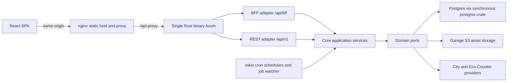

# 163 - Architecture Review and Remediation Plan

Status: in progress

## Purpose

A structured architecture review of the bike_counter repository: what the system
looks like today, which structural decisions hold up, and the major findings
that should drive the next refactoring cycle. This plan is the review artifact;
the implementation work it proposes is tracked in the roadmap at the end and
must be split into its own numbered plans when picked up.

## Scope

- Backend crate [`backend/src`](backend/src) (hexagonal core, driven and driving
  adapters, composition root, jobs, migrations).
- Frontend SPA [`frontend/src`](frontend/src) (routing, data fetching, build).
- Runtime topology ([`docker-compose.yml`](docker-compose.yml:1),
  [`frontend/nginx.conf.template`](frontend/nginx.conf.template:1),
  [`backend/Dockerfile`](backend/Dockerfile:1)).
- Delivery pipeline ([`.github/workflows/ci.yml`](.github/workflows/ci.yml:1),
  [`Makefile`](Makefile:51), [`agents.md`](agents.md:51)).

Out of scope: provider-specific parsing correctness, UI visual design, and
content of individual historical plans under [`plans/`](plans).

## Method

Static review only (no code changes, no load tests): module dependency and
layering checks, request-path tracing from browser to SQL, dependency and
middleware inventory, configuration/secrets review, deployment and CI inspection,
and consistency checks between documented invariants and the code.

## System overview

Key structural facts:

- **Modular monolith, one crate, one binary.** `main.rs` declares `mod core` and
  `mod adapter`; the crate root is the composition root
  ([`main.rs`](backend/src/main.rs:95)) and there is no `lib.rs`, so nothing can
  be linked by an external integration test.
- **Hexagonal layering is genuinely clean.** `core` has zero imports from
  `adapter` (verified by search); the domain defines ports and the application
  services depend only on ports. This is the strongest part of the codebase.
- **Two HTTP surfaces in one router**: the public REST API and a BFF for the SPA,
  sharing one [`AppState`](backend/src/adapter/driving/rest/handlers/mod.rs:50).
- **BFF page model**: a cheap page shell plus independently cacheable card
  sub-resources with `as_of` pinning, strong ETags and `If-None-Match` handling
  ([`cache.rs`](backend/src/adapter/driving/bff/cache.rs:58)).
- **Analytics read model**: hourly/daily rollup tables maintained by a scheduled
  job and refreshed after each import, with a raw-table fallback until the
  backfill completes ([`measurement_repository.rs`](backend/src/adapter/driven/postgres/measurement_repository.rs:1370)).
- **Background work**: five independent tokio cron loops plus a 30 s job
  reconciliation watcher ([`main.rs`](backend/src/main.rs:407)), guarded by a
  DB-backed lock table with heartbeats and leases
  ([`job_repository.rs`](backend/src/adapter/driven/postgres/job_repository.rs:83)).

## Strengths worth preserving

1. Ports-and-adapters separation with no inward-inverted dependencies in `core`.
2. Idempotent imports on a natural key
   (`channel_id, timestamp, resolution_seconds`) with `ON CONFLICT DO NOTHING`
   ([`measurement_repository.rs`](backend/src/adapter/driven/postgres/measurement_repository.rs:469)).
3. Multi-instance-safe job claiming, heartbeat leases and stale-job reconciliation.
4. Pre-aggregated rollups with explicit read indexes and a documented cold-start
   fallback ([`V26__add_rollup_read_indexes.sql`](backend/migrations/V26__add_rollup_read_indexes.sql:23)).
5. HATEOAS + ETag/`Cache-Control` discipline on BFF JSON and binary assets.
6. Network isolation: Postgres and Garage have no published ports and live on
   separate internal networks ([`docker-compose.yml`](docker-compose.yml:128)).
7. Strong automated gates: rustfmt, clippy `-D warnings`, production-only
   coverage thresholds, Vitest whole-`src` coverage, Playwright against the real
   stack, and a committed e2e fixture.
8. No third-party map/tile dependency at runtime; self-hosted PMTiles basemap.

## Major findings

Severity is relative to production risk and cost of the refactor.

| # | Finding | Severity |
|---|---|---|
| F1 | Synchronous DB driver behind an async HTTP layer caps concurrency at an unconfigurable pool of 10 | High |
| F2 | BFF read paths issue per-request N+1 queries and full-table loads | High |
| F3 | No HTTP middleware: no request tracing, timeouts, compression, body limits or rate limiting | High |
| F4 | All mutating/admin endpoints are unauthenticated and the backend port is published directly | High |
| F5 | Readiness is coupled to third-party providers via untimed TCP connects | High |

**Status of F1-F5: addressed in [`164`](plans/164_f1_f5_hardening_plan.md:1).**
F1 is addressed with explicit capacity controls plus a decision gate; the driver
migration itself is tracked in
[`170`](plans/170_async_db_driver_evaluation_plan.md:1).
| F6 | Composition root is a 530-line manual wiring script with a 14-field shared state | Medium-High |
| F7 | Oversized modules and a 24-method `MeasurementRepository` port | Medium |
| F8 | Stringly-typed error model without causes or error codes | Medium |
| F9 | Configuration and secrets only from a mounted TOML file, no env overrides | Medium |
| F10 | Frontend ships one eager bundle and re-implements data fetching per card | Medium |
| F11 | Unpartitioned measurements table and rollup readiness tracked in process memory | Medium |
| F12 | Single-host assumptions baked into tiles delivery and scheduling | Medium |
| F13 | CI does not enforce the documented Definition of done | Low-Medium |
| F14 | Plan-file sprawl and duplicated plan numbers, no ADR history | Low |

### F1 - Synchronous DB driver behind an async HTTP layer

**Evidence.** The backend uses the blocking `postgres` crate with `r2d2`
([`pool.rs`](backend/src/adapter/driven/postgres/pool.rs:16)). The pool size is a
hardcoded constant `DEFAULT_POOL_MAX_SIZE = 10` with a 5 s `get()` timeout
([`pool.rs`](backend/src/adapter/driven/postgres/pool.rs:31)). Every handler
funnels work through [`blocking()`](backend/src/adapter/driving/rest/handlers/mod.rs:129)
into `spawn_blocking`, and [`S3AssetStorage`](backend/src/adapter/driven/s3_asset_storage.rs:54)
carries its own nested tokio runtime to bridge async S3 calls from blocking
contexts.

**Impact.** A single request can hold a blocking thread while queuing for one of
ten connections. Concurrency is bounded by the DB pool, not by CPU, and every
waiting request occupies a blocking-pool thread. Under a modest burst (one map
pan triggers three endpoints, see F2) requests serialize and latency degrades to
multiples of the 5 s acquisition timeout, which then surfaces as 500s
(`DomainError::Database` from the pool timeout).

**Recommendation.** Either migrate the persistence adapters to `sqlx` or
`tokio-postgres` (the ports are already async-friendly at the boundary, the
inconvenience is confined to `adapter/driven/postgres/*`), or, as an interim
step, make the pool size and acquisition timeout configurable, add a
`tower::limit::ConcurrencyLimitLayer` sized to the pool, and stop nesting
runtimes inside `S3AssetStorage`. Add a load test that asserts a p95 latency
budget for the sidebar triple-request.

### F2 - BFF read paths issue N+1 queries and full-table loads

**Evidence.**

- [`metric_windows()`](backend/src/core/application/station_analytics/metrics.rs:167)
  loops over every station, and inside the loop performs two aggregate queries
  per metric window (four windows) - up to eight queries per station for a
  multi-station summary.
- [`channel_maps()`](backend/src/core/application/station_analytics/service.rs:264)
  fetches every channel in the system on each sidebar/stats/summary request, even
  when the request is scoped to a viewport.
- [`station_image_urls()`](backend/src/adapter/driving/bff/handlers.rs:211) runs
  one blocking asset lookup per distinct linked asset, and the data-source list
  calls [`data_source_image_url()`](backend/src/adapter/driving/bff/handlers.rs:1298)
  once per row.
- On the client, every bounds change fires three requests
  ([`useVisibleStations.ts`](frontend/src/features/stations/useVisibleStations.ts:37)),
  and the detail page fires shell, overview, graphs and monthly
  ([`StationDetail.tsx`](frontend/src/features/stationDetail/StationDetail.tsx:190)).

**Impact.** Cost scales with station count times endpoints, not with the size of
the requested viewport. Combined with F1 the effect is amplified: the expensive
part of each request traverses the same ten-connection bottleneck.

**Recommendation.** Push the aggregation into single set-based statements
(`GROUP BY station_id` over the channel id array, one query per metric kind
instead of per station), derive channel counts from a `GROUP BY` join instead of
loading the channel table, and resolve image URLs in the same query via
`LEFT JOIN assets`. Only then consider a read cache keyed by `bounds + as_of`.

### F3 - No HTTP middleware layer

**Evidence.** [`create_router()`](backend/src/adapter/driving/rest/mod.rs:105)
registers routes and `.with_state(...)` only. A repository-wide search for
`TraceLayer|CorsLayer|CompressionLayer|TimeoutLayer|tower_http` returns zero
matches, and `tower-http` is not a dependency in
[`Cargo.toml`](backend/Cargo.toml:7). The nginx template adds no `gzip`, no
security headers and no request limits
([`nginx.conf.template`](frontend/nginx.conf.template:1)).

**Impact.** No per-request span or latency/status observability (only ad-hoc
`tracing` calls inside services); no defence against slow or abusive clients; no
response compression for JSON payloads that are tens to hundreds of kB; no
`X-Content-Type-Options` / `Referrer-Policy` / CSP at the edge. Failures such as
pool exhaustion cannot be attributed to a route or caller.

**Recommendation.** Add a `tower-http` stack: `TraceLayer` with a request id and
route span, `TimeoutLayer` per surface (BFF short, opendata longer),
`CompressionLayer`, `RequestBodyLimitLayer`, and a rate limit on the expensive
BFF endpoints. Mirror the basics in nginx: gzip for `application/json`, security
headers, `client_max_body_size`.

### F4 - Unauthenticated administrative mutations on a published port

**Evidence.** The router exposes `PATCH /api/v1/counting-stations/{id}`,
`PUT`/`DELETE /api/v1/data-sources/{id}/persistent_state...`,
`DELETE /api/v1/data-sources/{id}/imported_until` and
`POST /api/v1/jobs/{id}/cancel`
([`rest/mod.rs`](backend/src/adapter/driving/rest/mod.rs:167)). A search for
inbound authentication finds only outbound provider bearer tokens; there is no
extractor, layer or proxy rule providing authentication. The backend publishes
port 8080 to the host directly
([`docker-compose.yml`](docker-compose.yml:45)), bypassing nginx, and nginx
itself has no `auth_basic`.

**Impact.** Anyone who can reach the host can rewrite station metadata, wipe
import watermarks and persistent state, or cancel running jobs. Deployment
behind a reverse proxy does not help while 8080 remains published, and the
Swagger UI advertises the endpoints.

**Recommendation.** Split the write surface into an explicitly admin-tagged
router protected by a token or mTLS (config-provided, constant-time compared),
keep `/api/v1` read-only for anonymous access, publish 8080 on loopback only or
not at all, and add REST tests that assert 401/403 for every mutating route.

### F5 - Readiness coupled to third-party providers with untimed connects

**Evidence.** Readiness aggregates a Postgres probe plus one indicator per
configured data source
([`main.rs`](backend/src/main.rs:229)), executed strictly serially
([`service.rs`](backend/src/core/domain/health/service.rs:20)). Each provider
`check_health()` opens a raw `TcpStream::connect` with no timeout (for example
[`bonn_opendata/adapter.rs`](backend/src/adapter/driven/bonn_opendata/adapter.rs:311))
and treats TCP reachability as health. The container healthcheck allows 5 s
([`backend/Dockerfile`](backend/Dockerfile:56)) while seven serial connects can
far exceed it; the frontend container gates on `service_healthy`
([`docker-compose.yml`](docker-compose.yml:111)).

**Impact.** A slow or unreachable city endpoint marks an otherwise healthy
backend as not ready, flaps the container health status, can delay or block the
frontend start, and leaves the readiness request's blocking task running after
the probe has already timed out.

**Recommendation.** Define readiness as "Postgres reachable"; expose provider
reachability on a separate, non-gating endpoint that caches results, runs checks
concurrently and uses `TcpStream::connect_timeout` (or an HTTP HEAD with a
timeout). Never let a third party decide whether this service may receive
traffic.

### F6 - Composition root and shared state

**Evidence.** [`main.rs`](backend/src/main.rs:121) constructs roughly twenty
collaborators and fourteen services in one function;
[`RestApiAdapter::new`](backend/src/adapter/driving/rest/mod.rs:65) takes fourteen
arguments and `AppState` carries fourteen trait objects. The crate root opts out
of dead-code analysis with `#![allow(dead_code)]`
([`main.rs`](backend/src/main.rs:1)). Startup also panics on S3/Garage
initialization failures
([`main.rs`](backend/src/main.rs:237)), so a transient storage outage prevents
the HTTP server from binding.

**Impact.** Wiring cannot be tested without real Postgres and Garage, the shared
state object is a forwarding hub that couples unrelated surfaces (assets, REST
admin, BFF analytics, opendata), and the global `allow(dead_code)` hides
abandoned code.

**Recommendation.** Introduce a composition module that returns typed
surface-specific states (BFF state, read-API state, admin state, job context),
remove the crate-wide `allow`, and treat Garage initialization failures as a
degraded-health condition rather than a boot failure.

### F7 - Oversized modules and a broad repository port

**Evidence.** `data_source_update_service.rs` (~2.7k lines),
`data_import_service.rs` (~2.4k), `measurement_repository.rs` (~3.1k),
`bff/handlers.rs` (~1.4k) and `configuration_toml_adapter.rs` (~1k).
[`MeasurementRepository`](backend/src/core/domain/measurements/repository_port.rs:154)
declares 24 methods spanning CRUD, bucketed aggregates, radars, coverage,
bounds, rollup maintenance and readiness, which forces every test double to stub
dozens of `unimplemented!()` methods (visible in
[`metrics.rs`](backend/src/core/application/station_analytics/metrics.rs:251)).

**Impact.** Low cohesion makes review and change expensive, mocks encode the
whole surface, and per-feature parsing rules are buried in a single configuration
adapter.

**Recommendation.** Split the measurement port into read, write, rollup and
coverage ports and inject only what a service needs; split the configuration
adapter per section (database, data sources, storage, maps, jobs); move the BFF
handlers into per-page modules (they are already routed per page).

### F8 - Stringly-typed error model

**Evidence.** [`DomainError`](backend/src/core/domain/error.rs:4) has
`Database(String)` and `Provider(String)` variants and no `source()`. Mapping to
HTTP happens in one place
([`map_domain_error`](backend/src/adapter/driving/rest/handlers/mod.rs:74)), but
the original cause is flattened to text and only logged as a free-form line.

**Impact.** No machine-readable error codes for clients, no error chains for
diagnosis, and every new error class requires touching the central mapping.

**Recommendation.** Adopt `thiserror`, keep `#[from]`/`#[source]` causes, and add
a stable `code` field to `ErrorResponseDto` while preserving the current
external messages (no internal detail leakage).

### F9 - Configuration and secrets

**Evidence.** Configuration is read exclusively from `config.toml`
([`main.rs`](backend/src/main.rs:128)); a search for `std::env::var` in the
backend returns nothing. Database and S3 credentials appear in plaintext in
[`config.toml.example`](config.toml.example:1) and are duplicated as compose
environment values ([`docker-compose.yml`](docker-compose.yml:9)).

**Impact.** Container platforms cannot inject secrets without writing a file,
rotation requires a redeploy with a new secret volume, and the example file
encourages copying production credentials into a repo-adjacent file.

**Recommendation.** Support environment overrides for secrets
(`DATABASE_PASSWORD`, `ASSET_STORAGE_SECRET_KEY`, ...) layered over the TOML,
document precedence, and use Docker/Compose secrets for the shipped stack.

### F10 - Frontend bundle and data layer

**Evidence.** [`App.tsx`](frontend/src/App.tsx:2) eagerly imports all four pages,
so `maplibre-gl`, `pmtiles`, `recharts`, `supercluster` and every Radix package
land in one bundle; [`vite.config.ts`](frontend/vite.config.ts:14) has no
`build.rollupOptions.output.manualChunks` and no lazy routes. Fetching is
re-implemented per card with a local hook
([`useResource.ts`](frontend/src/features/stationDetail/useResource.ts:10)) and
per feature module, with no shared cache, deduplication, retry or background
revalidation.

**Impact.** Non-map pages pay the map bundle cost; navigating between two
stations refetches everything; there is no consistent loading/error/retry
policy; the number of concurrent BFF calls per page is higher than necessary.

**Recommendation.** `React.lazy` the routes with a map-only chunk boundary, add
`manualChunks` for the map and chart libraries, and introduce a single query
layer (for example TanStack Query) that keys on the HATEOAS URLs, deduplicates
in-flight requests and reuses the ETag cache the backend already provides.

### F11 - Measurement table growth and rollup readiness

**Evidence.** `measurements` is a plain unpartitioned table from the first
migration ([`V1__create_measurements.sql`](backend/migrations/V1__create_measurements.sql:14))
and only gained indexes later. Rollup readiness is cached per process in an
`AtomicBool` plus a single-row state table
([`measurement_repository.rs`](backend/src/adapter/driven/postgres/measurement_repository.rs:36)).
Rollups are refreshed synchronously inside the import path as well as by cron.

**Impact.** Vacuum, index maintenance and retention become progressively more
expensive; a process that has not yet observed the ready flag silently falls back
to raw scans, which is exactly when load is highest (fresh import). There is no
metric for rollup lag.

**Recommendation.** Partition `measurements` by month (native partitioning with
a maintenance job) and plan a retention policy for sub-hourly resolutions;
publish rollup lag and readiness as metrics; make the readiness check a cheap
indexed read with a short TTL instead of a process-local boolean.

### F12 - Single-host assumptions in tiles and scheduling

**Evidence.** The basemap archive is written to a host bind mount shared between
backend and frontend
([`docker-compose.yml`](docker-compose.yml:44)) and served by nginx as a static
file ([`nginx.conf.template`](frontend/nginx.conf.template:25)). Five cron loops
run inside every replica; correctness relies on the DB lock, but the multi-GB
artifact and the `tiles_update` job do not.

**Impact.** Scaling the backend horizontally means every replica may attempt a
multi-GB tile build into its own local path; the frontend would serve whichever
copy its mount points at. The documented "single image" operating model is
implicit rather than enforced.

**Recommendation.** State the supported topology explicitly in `README` and
`agents.md`, and either publish tiles/opendata artifacts to object storage for
multi-replica deployments or gate `tiles_update` to a designated instance.

### F13 - CI does not enforce the documented Definition of done

**Evidence.** [`agents.md`](agents.md:165) requires `make check`, `make test`,
`make coverage` and `make test-playwright`. The CI workflow runs rustfmt,
clippy, coverage, Prettier and Vitest
([`ci.yml`](.github/workflows/ci.yml:57)) but not `cargo audit`, not a Docker
image build, and not Playwright.

**Impact.** Dependency advisories, image build breakage and browser-level
regressions are only found locally or after release.

**Recommendation.** Add an audit job, a Docker build job for both images, and a
scheduled nightly Playwright job; keep pull-request CI fast.

### F14 - Plan sprawl and missing decision records

**Evidence.** `plans/` contains 160+ numbered documents with duplicated numbers
(`126`, `128`, `157`) and no index; architecture decisions are only recoverable
by reading individual plans.

**Impact.** New contributors cannot see the current architecture rules or the
reasoning behind them, and duplicate numbers make references ambiguous.

**Recommendation.** Introduce `docs/adr/` for durable decisions, add a short
index that maps plan ranges to topics, and renumber or mark the duplicated
plans as superseded.

## Remediation roadmap

Ordered by risk reduction per unit of change. Each phase becomes its own
numbered plan before implementation.

1. **Security and availability quick wins.**
   - Authenticate or hide the mutating `/api/v1` endpoints; stop publishing
     backend port 8080 (F4).
   - Redefine readiness as Postgres-only and add a separate cached provider
     endpoint with connect timeouts (F5).
   - Add `tower-http` tracing, timeout, compression and body limits, plus nginx
     gzip and security headers (F3).
2. **Observability baseline.**
   - Structured request spans with route, status and duration; a metric export
     for request counts/latency, job durations and rollup lag (F3, F11).
   - Typed errors with codes and causes (F8).
3. **Read-path performance.**
   - Replace the per-station metric loop and full channel loads with set-based
     queries; batch asset URL resolution (F2).
   - Make the DB pool configurable and bound request concurrency; document the
     capacity model (F1).
4. **Data lifecycle.**
   - Partition `measurements`, define retention for sub-hourly data, and
     replace the process-local rollup readiness flag (F11).
5. **Structural refactors.**
   - Split `AppState` into surface-specific states and extract the composition
     root; remove `#![allow(dead_code)]` (F6).
   - Split `MeasurementRepository` and the oversized services/handlers (F7).
6. **Configuration and frontend.**
   - Environment overrides and Docker secrets (F9).
   - Route-level code splitting and a shared query layer (F10).
7. **Process.**
   - Extend CI, add ADRs, add the plans index (F13, F14).

## Risks and non-goals

- Migrating off the synchronous `postgres` crate is the largest single change;
  do it behind the existing ports and only after the read-path queries are
  fixed, so the migration does not mask a query-shape problem.
- Adding authentication changes the public API contract; it must be documented
  in the README and the OpenAPI document in the same change.
- Do not lower coverage thresholds to accommodate any of these refactors.

## Definition of done

- [x] Repository context gathered (entry point, core, adapters, frontend,
      deployment, CI)
- [x] Layering verified: `core` has no dependency on `adapter`
- [x] Request path traced from browser through nginx, Axum, core port and SQL
- [x] Findings documented with evidence links and severity
- [x] Remediation roadmap ordered and sized into independent phases
- [x] F1 phase planned as its own numbered plan (pool, concurrency, driver) —
      capacity controls implemented in [`164`](plans/164_f1_f5_hardening_plan.md:1);
      the async-driver migration is evaluated in
      [`170`](plans/170_async_db_driver_evaluation_plan.md:1)
- [x] F2 phase planned as its own numbered plan (set-based analytics + asset
      batch) — implemented in [`164`](plans/164_f1_f5_hardening_plan.md:1)
      (workstream D)
- [x] F3/F4/F5 phase planned and implemented (middleware, auth, readiness split)
      — implemented in [`164`](plans/164_f1_f5_hardening_plan.md:1)
      (workstreams A, B, C)
- [ ] F6/F7 phase planned and implemented (composition root, port split)
- [ ] F9/F10 phase planned and implemented (config env overrides, frontend split)
- [ ] F11/F12 decisions recorded as ADRs
- [ ] F13 CI jobs added; F14 ADR folder and plans index created
- [ ] `make check`, `make test`, `make coverage` green after each phase
- [ ] `make test-playwright` green for any frontend-facing phase
- [ ] README updated with the supported topology and the API authentication model
