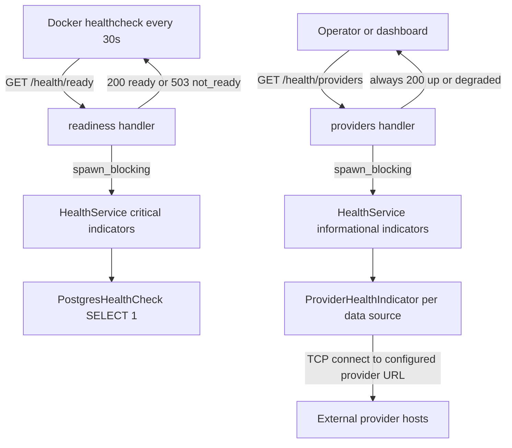

# 163 - Decouple readiness from external provider URLs

Status: implemented

## Problem

`/health/ready` currently aggregates **one health indicator per configured data
source** in addition to the PostgreSQL probe:

- [`main.rs`](backend/src/main.rs:227) builds
  `PostgresHealthCheck` + `startup.provider_health_indicators` into a single
  `HealthService`.
- Every provider indicator delegates to `DataProvider::check_health`
  ([`ProviderHealthIndicator`](backend/src/core/domain/health/provider_health_indicator.rs:21)),
  and every adapter implements that as a **TCP connect to the configured external
  URL**:

| Adapter | URL field used for the probe |
|---|---|
| [`MuensterGithubAdapter`](backend/src/adapter/driven/muenster_github/adapter.rs:651) | `url` |
| [`BonnOpendataAdapter`](backend/src/adapter/driven/bonn_opendata/adapter.rs:302) | `measurements_url` |
| [`LeipzigWfsAdapter`](backend/src/adapter/driven/leipzig_wfs/adapter.rs:318) | `stations_url` |
| [`HamburgStaAdapter`](backend/src/adapter/driven/hamburg_sta/adapter.rs:512) | `base_url` |
| [`EcoCounterV1Adapter`](backend/src/adapter/driven/eco_counter/v1/adapter.rs:490) | `base_url` |
| [`EcoCounterV2Adapter`](backend/src/adapter/driven/eco_counter/v2/adapter.rs:360) | `base_url` |
| [`EcoCounterWebAdapter`](backend/src/adapter/driven/eco_counter/scraping/adapter.rs:497) | `base_url` |

Consequences today:

1. **The container is marked unhealthy when any upstream open-data host is
   unreachable.** [`docker-compose.yml`](docker-compose.yml:52) probes
   `http://localhost:8080/health/ready` every 30 s, so an offline host or a
   provider outage flips the whole stack to `unhealthy` even though the service
   itself (DB + HTTP) is fine.
2. **Readiness latency is coupled to external TCP connect timeouts**
   (`TcpStream::connect` to an unreachable host can block for the OS connect
   timeout).
3. **The e2e stack has to special-case this**: the offline Playwright run
   overrides the backend healthcheck to `/health/live`
   ([`frontend/e2e/docker-compose.e2e.yml`](frontend/e2e/docker-compose.e2e.yml:35))
   precisely "so readiness never pings the providers"
   ([`scripts/e2e-playwright.sh`](scripts/e2e-playwright.sh:14)).
4. Provider reachability is only visible by making the **critical** readiness
   verdict fail — there is no way to observe "providers down, service still
   ready".

Exposure note (unchanged by this plan): nginx only reverse-proxies `/api/`
([`frontend/nginx.conf.template`](frontend/nginx.conf.template:39)), so
`/health/*` is **not** reachable through the public frontend URL; it is an
internal endpoint on the backend port (used by the Docker healthcheck and
operators inside the Docker network).

## Decision

- **`/health/ready` = internal dependencies only (PostgreSQL).** Response shape
  and HTTP semantics stay exactly as today (`200` + `status=ready` when every
  critical indicator is up, `503` + `status=not_ready` otherwise). It performs
  **no external network I/O**.
- **Provider reachability moves to a new informational endpoint
  `GET /health/providers`** that **always returns `200`** and reports each
  configured data source as a component (`status` `up`/`down`, `error` when
  down). Its overall `status` is `up` when all providers are reachable and
  `degraded` otherwise, but that value **never** maps to a non-200 response and
  is never consulted by readiness.
- The probe stays synchronous/TCP but runs on the blocking pool in the handler
  (same `spawn_blocking` pattern as readiness), so provider probes can never
  occupy a tokio worker thread. No caching and no background prober: the
  endpoint is on-demand diagnostics only.
- The e2e `/health/live` override is **kept** (no behaviour change for the
  frontend/e2e setup); only its comments are corrected because readiness is now
  DB-only.

## API contract

`GET /health/ready` (unchanged shape, critical indicators only):

```json
{
  "status": "ready",
  "components": [{ "name": "postgres", "status": "up" }]
}
```

`GET /health/providers` (new, always `200`):

```json
{
  "status": "degraded",
  "components": [
    { "name": "postgres", "status": "up" },
    { "name": "Münster/münster_opendata_github_provider", "status": "up" },
    {
      "name": "Bonn/bonn_opendata_provider",
      "status": "down",
      "error": "ConnectionRefused"
    }
  ]
}
```

The `components` array of `/health/providers` lists **only** the informational
(provider) indicators — the critical set belongs to `/health/ready`. The example
above shows both arrays separately; `/health/providers` returns just the
provider components.

## Architecture



## Implementation steps

1. **Core domain — split critical vs informational indicators**
   ([`service.rs`](backend/src/core/domain/health/service.rs:10))
   - `HealthService` gains two vectors: `critical` and `informational`.
   - `HealthService::new(critical)` stays as the existing constructor and starts
     with an **empty** informational set (keeps
     [`mocks.rs`](backend/src/adapter/driving/rest/tests/mocks.rs:613) and the
     service's own tests source-compatible).
   - Replace the old single-set constructor with
     `HealthService::new(critical, informational)` (a single always-used
     constructor; a test-only `new(critical)` would be dead code in the binary
     target and fail `clippy -D warnings`).
   - `check()` runs **critical only**, `check_details()` runs **informational
     only**; both keep the existing per-indicator ordering.
   - Update the module doc comment; add unit tests: critical-only selection,
     informational-only selection, empty informational set, ordering preserved.

2. **Core domain — extend the driving port**
   ([`service_port.rs`](backend/src/core/domain/health/service_port.rs:6))
   - Add `fn check_details(&self) -> Vec<HealthComponent>;` documented as
     "informational only — must never gate readiness".
   - `HealthService` is the only implementor (verified: no other impl exists),
     so no further implementations need updating.
   - Update [`health/mod.rs`](backend/src/core/domain/health/mod.rs:1) and
     [`indicator_port.rs`](backend/src/core/domain/health/indicator_port.rs:1)
     docs to describe the two roles (critical vs informational).

3. **REST adapter — new handler**
   ([`handlers/health.rs`](backend/src/adapter/driving/rest/handlers/health.rs:30))
   - Add `get_health_providers(State(state)) -> Json<HealthDto>`:
     - run `health_service.check_details()` inside
       `tokio::task::spawn_blocking` (the sync probes must not run on a tokio
       worker);
     - map a `JoinError` to a single `backend` component with
       `HealthStatus::Down(...)` and return it with `status = "degraded"`;
     - compute the overall status as `up` when all components are up, otherwise
       `degraded`;
     - always return `200 OK` (document this in the `#[utoipa::path]`
       responses).
   - Annotate with `#[utoipa::path(get, path = "/health/providers", tag =
     "Health", ...)]` and a 200-only response list.

4. **REST adapter — routing**
   ([`rest/mod.rs`](backend/src/adapter/driving/rest/mod.rs:275))
   - Import `get_health_providers` and add
     `.route("/health/providers", get(get_health_providers))` next to
     `/health/live` and `/health/ready`.
   - Keep all three health routes outside the `/api/v1` namespace.

5. **REST adapter — DTO reuse**
   ([`dto/health.rs`](backend/src/adapter/driving/rest/dto/health.rs:31))
   - Reuse `HealthDto::with_components`; no new DTO type is required. Only add a
     small doc comment clarifying that `components` carries the critical set on
     `/health/ready` and the informational provider set on `/health/providers`.

6. **OpenAPI**
   ([`openapi.rs`](backend/src/adapter/driving/rest/openapi.rs:114))
   - Add `get_health_providers` to `paths(...)`.
   - Extend the `Health` tag description to mention the informational provider
     probe, and mention `/health/providers` in the info description next to the
     existing `/health/live` + `/health/ready` sentence.

7. **Root HATEOAS links**
   ([`dto/root.rs`](backend/src/adapter/driving/rest/dto/root.rs:35),
   [`handlers/root.rs`](backend/src/adapter/driving/rest/handlers/root.rs:25))
   - Add `health-providers` -> `/health/providers` alongside `health-live` and
     `health-ready`, and mirror it in the handler's documented example payload.

8. **Wiring**
   ([`main.rs`](backend/src/main.rs:227))
   - Build the service as
     `HealthService::new(vec![Arc::new(PostgresHealthCheck::new(pool.clone()))], provider_health_indicators)`
     and update the comment to state that readiness is critical-only while
     provider reachability is reported by `/health/providers`.

9. **REST tests**
   - [`tests/mocks.rs`](backend/src/adapter/driving/rest/tests/mocks.rs:613):
     keep `mock_health_service(status)` (critical-only) and add
     `mock_health_service_with_providers(postgres: HealthStatus, providers:
     Vec<(&str, HealthStatus)>)` built with `HealthService::new`.
   - [`tests/health.rs`](backend/src/adapter/driving/rest/tests/health.rs:18):
     - readiness ignores providers: critical `Up` + informational `Down` =>
       `200`, `status = ready`, `components` contains only `postgres`;
     - `/health/providers` all up => `200`, `status = up`, one component per
       provider with `status = up` and no `error`;
     - `/health/providers` with a down provider => `200` (**not** 503),
       `status = degraded`, that component has `status = down` and its `error`
       message;
     - `/health/providers` with no configured providers => `200`,
       `status = up`, empty `components` array;
     - `openapi_document_contains_health_paths` also asserts
       `/health/providers`.
   - [`tests/root.rs`](backend/src/adapter/driving/rest/tests/root.rs:30):
     assert the new `health-providers` link.

10. **Docs and operational comments**
    - [`README.md`](README.md:118): document the three endpoints — liveness,
      readiness (**internal dependencies only, no external provider pings**) and
      the informational `/health/providers` (always `200`, `up`/`degraded`,
      may be slow when a provider host is unreachable because it performs a TCP
      connect per data source).
    - [`docker-compose.yml`](docker-compose.yml:51): comment that the healthcheck
      target `/health/ready` checks PostgreSQL only and therefore no longer
      depends on external open-data hosts.
    - [`frontend/e2e/docker-compose.e2e.yml`](frontend/e2e/docker-compose.e2e.yml:7)
      and [`scripts/e2e-playwright.sh`](scripts/e2e-playwright.sh:14): keep the
      `/health/live` override but correct the rationale (readiness is DB-only
      now; `/health/live` is kept so the boot wait needs neither the DB probe nor
      the providers).
    - [`agents.md`](agents.md:136): same comment correction in the
      "Frontend e2e (Playwright)" section.
    - [`plans/03_health_check_plan.md`](plans/03_health_check_plan.md:1): add a
      one-line note that the provider part of readiness is superseded by this
      plan (keep `Status: implemented` for the historical record).

## Test plan (summary)

| Layer | Test |
|---|---|
| core | `HealthService::check()` returns only critical indicators |
| core | `HealthService::check_details()` returns only informational indicators |
| core | `HealthService::new(...)` has no informational details |
| REST | readiness stays `200 ready` when a provider is down |
| REST | `/health/providers` returns `200 up` with all providers up |
| REST | `/health/providers` returns `200 degraded` (never 503) with a down provider incl. `error` |
| REST | `/health/providers` without providers returns `200 up` + empty components |
| REST | OpenAPI exposes `/health/providers`; root exposes the `health-providers` link |

## Out of scope

- Removing or changing the provider `check_health()` implementations (they stay
  the data source for `/health/providers`).
- Adding timeouts/retries to the provider TCP probes (documented as a known
  characteristic; a follow-up can add a bounded connect timeout).
- Exposing `/health/*` through nginx (they remain internal on the backend port).
- Changing the `/health/live` semantics or the Docker healthcheck target.

## Risks

- **Behaviour change for operators** who relied on `/health/ready` to detect
  upstream failures: the new `/health/providers` endpoint is the replacement and
  must be documented in the README.
- **Trait change** (`HealthServicePort::check_details`): only `HealthService`
  implements it today; any out-of-tree implementor would break — acceptable in
  this single-crate backend.
- **Slow responses** on `/health/providers` when a provider host is unreachable
  (OS TCP connect timeout). Mitigated by running it on the blocking pool and by
  keeping it out of any healthcheck.

## Codecov patch coverage follow-up

The first push tripped the Codecov patch status (89.77 %, 9 uncovered lines):

- `rest/handlers/health.rs` — the `spawn_blocking` join-error branch was not
  reachable from the endpoint tests. The mapping is now the pure
  `providers_report(result)` helper with unit tests for up, degraded, join error
  and empty, so every branch of the informational response is covered.
- `main.rs` — the wiring lines are straight-line composition-root code that no
  unit test can execute. The composition root is now excluded from the
  production coverage scope in [`scripts/coverage.sh`](scripts/coverage.sh),
  [`scripts/lcov-production-only.sh`](scripts/lcov-production-only.sh) and
  [`codecov.yml`](codecov.yml) (all three mirror each other) and documented in
  [`agents.md`](agents.md:63).

## Definition of done

- [x] Codecov patch coverage has no uncovered backend lines (informational-response mapping fully tested; composition root excluded from the coverage scope)
- [x] `HealthService` distinguishes critical and informational indicators; `check()` and `check_details()` covered by core unit tests
- [x] `HealthServicePort::check_details` added and documented as informational-only
- [x] `main.rs` wires Postgres as critical and the provider indicators as informational
- [x] `GET /health/providers` implemented, always `200`, `up`/`degraded`, per-provider components with `error`
- [x] `/health/ready` response shape and `200`/`503` semantics unchanged and free of external calls
- [x] OpenAPI contains `/health/providers`; root HATEOAS exposes `health-providers`
- [x] REST tests cover readiness independence, providers up/down/empty, OpenAPI path, root link
- [x] README, `docker-compose.yml` comment, e2e compose/script and `agents.md` comments corrected; plan 03 notes the supersession
- [x] `make check` green — `cargo fmt --check`, `cargo clippy --all-targets -- -D warnings`, frontend Prettier and `cargo audit`
- [x] `make test-rest` (140 passed) and `make test` (858 passed) green
- [x] `make coverage` green — backend overall (production) 88.53 % (≥ 80 %), core 97.14 % (≥ 95 %); frontend Vitest thresholds also pass
- [x] `make test-playwright` green — 76 passed

## Verification

Run on the feature branch with the frontend dependencies installed (`npm ci`,
`playwright install chromium`) and a pre-built basemap archive in place.

| Command | Result |
|---|---|
| `make check` | OK (fmt, `clippy --all-targets -D warnings`, Prettier, `cargo audit` with 1 allowed yanked-crate warning) |
| `cargo test core::domain::health` | 8 passed |
| `make test-rest` | 140 passed |
| `make test` | 858 passed |
| `make coverage` | backend overall 88.53 %, core 97.14 %; frontend Vitest ≥ thresholds |
| `make test-playwright` | 76 passed (2.5 min) |

**e2e prerequisite (documentation gap found while running the gate):**
`tiles/map.pmtiles` is **git-ignored** (`.gitignore:87`), so a fresh worktree has
no basemap. Without it, `useTilesReady` keeps the map on "Downloading map…", the
MapLibre map never mounts and every map-dependent spec fails (76 → 11 passing).
The archive has to be built once with `make tiles` (or hard-linked from an
existing checkout) before `make test-playwright`. [`agents.md`](agents.md:136)
claimed the archive is committed; that claim is corrected in this change.
