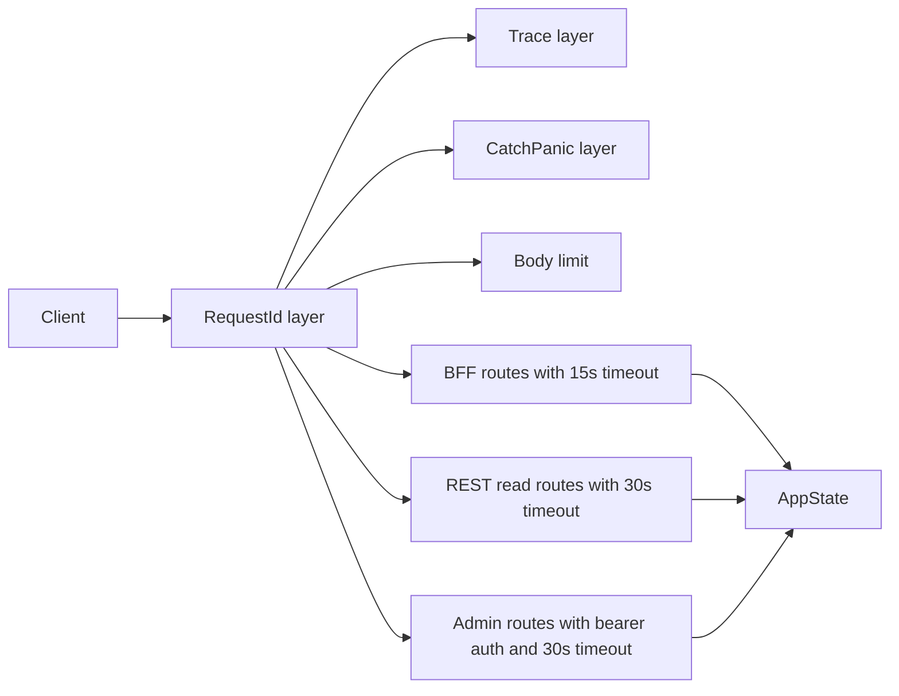

# 164 - F1 to F5 Hardening Plan: DB Capacity, Read Paths, HTTP Middleware, Admin Auth, Readiness

Status: implemented - all five workstreams landed and every gate (including
`make test-playwright` and the `EXPLAIN ANALYZE` evidence) is recorded below.
Merged with `main` (V28 + the build-time plan); see "Merge with main".

## Context

Findings F1 to F5 from the architecture review
([`163_architecture_review_plan.md`](plans/163_architecture_review_plan.md:1)):

| Finding | Short form |
|---|---|
| F1 | Synchronous DB driver behind async HTTP, hardcoded pool of 10 |
| F2 | Per-station N+1 aggregation and full-table loads on BFF read paths |
| F3 | No HTTP middleware: no spans, timeouts, compression, body limits |
| F4 | Unauthenticated admin mutations on a published port |
| F5 | Readiness coupled to third-party providers via untimed TCP connects |

This plan turns them into five independently shippable workstreams, in the
recommended execution order **A → B → C → D → E**. Nothing here changes the
database schema, so no refinery migration is required.

## Goals

1. The service must never become unready because a city website is slow.
2. No anonymous caller can mutate data or cancel jobs.
3. Every HTTP request is attributable: it carries a request id and produces one
   trace event with route, status and duration.
4. BFF read cost is independent of the number of stations for a given viewport.
5. Database concurrency limits are explicit, configurable and observable instead
   of an undocumented constant.

## Non-goals

- Migrating the persistence adapters to an async driver. F1 is addressed here
  with capacity controls plus a **decision gate** for a later pilot; the full
  async migration gets its own plan once the read-path shape is fixed (D).
- Splitting `AppState` or the composition root (F6), the repository ports (F7)
  or the error model (F8). Each remains its own plan.
- Any frontend redesign. Only the nginx template changes.

## Workstream A - HTTP middleware (F3)

### A1. Dependencies

In [`backend/Cargo.toml`](backend/Cargo.toml:7):

- Promote `tower` from `dev-dependencies` to `dependencies` (needed for
  `tower::limit::ConcurrencyLimitLayer`, used in workstream E).
- Add `tower-http` with features `trace`, `request-id`, `timeout`, `limit`,
  `catch-panic`, `set-header`.

Do **not** add the `compression-gzip` feature: edge compression is handled by
nginx to avoid double compression and ETag/`Content-Length` ambiguity on the
BFF's strong-ETag responses ([`cache.rs`](backend/src/adapter/driving/bff/cache.rs:58)
computes the ETag over the uncompressed body).

### A2. Router layering

In [`RestApiAdapter::create_router`](backend/src/adapter/driving/rest/mod.rs:105),
build three routers and merge them so each surface can carry its own policy:



Concretely:

1. `SetRequestIdLayer` (`x-request-id`) + `PropagateRequestIdLayer` so the id is
   generated when absent and echoed on the response.
2. `TraceLayer::new_for_http()` with a custom `make_span_with` capturing
   `method`, `path`, `request_id`; `on_response` emits `status` and
   `latency_ms`. Keep the existing `tracing` subscriber; no second framework.
3. `CatchPanicLayer` converting handler panics to a 500 response. This matters
   because several helpers `expect` infallible serialization and asset lookups.
4. `RequestBodyLimitLayer::new(1 MiB)`.
5. `TimeoutLayer` per sub-router: BFF 15 s, REST reads 30 s, opendata file
   routes 60 s. Note the limitation in the module doc: a timeout bounds the
   **response**, it does not cancel the `spawn_blocking` work already queued -
   load shedding is workstream E's job.

Important ordering rule: the request-id layer must be added **outside** the
trace layer, otherwise the span has no id. Layer order in Axum is
outermost-first (`.layer(a).layer(b)` applies `b` inside `a` when a is added
last) - verify with the header assertion test rather than by assumption.

### A3. nginx hardening

In [`frontend/nginx.conf.template`](frontend/nginx.conf.template:1):

- `gzip on; gzip_vary on; gzip_min_length 1024; gzip_types application/json application/javascript text/css image/svg+xml;`
- `client_max_body_size 1m;`
- Security headers on `/` and `/api/`: `X-Content-Type-Options: nosniff`,
  `Referrer-Policy: no-referrer`, `X-Frame-Options: SAMEORIGIN`.
- A `Content-Security-Policy` may be added only after validating MapLibre: it
  needs `blob:` workers and `data:`/`blob:` images for vector tiles. Gate this
  step behind a passing `make test-playwright` run; if the map breaks, ship the
  other headers and record the CSP as a follow-up.

### A4. Tests

- `rest/tests.rs`: a response generated without an `x-request-id` gains one; a
  request that supplies one gets it echoed.
- A 404 from an unknown path still passes through the trace layer (assert the
  request id is present).
- A handler that panics returns 500 with a JSON error body, not a dropped
  connection.

## Workstream B - Admin authentication (F4)

### B1. Configuration

Add an optional top-level `admin_token` to the TOML DTO
([`configuration_toml_adapter.rs`](backend/src/adapter/driven/configuration_toml_adapter.rs:20))
and to [`Configuration`](backend/src/core/domain/configuration/configuration.rs:39)
as `Option<Arc<str>>` with `admin_token() -> Option<&str>`:

- absent / empty -> admin routes are **not registered at all** (404), and
  startup logs one `warn!` explaining that data-mutating endpoints are disabled.
- present -> validate a minimum length of 16 characters, otherwise
  `ConfigError::InvalidFormat` blocks startup.
- never render the token: keep the existing redacted-config logging
  ([`main.rs`](backend/src/main.rs:162)).

### B2. Middleware

New module `backend/src/adapter/driving/rest/admin_auth.rs`:

- `struct AdminAuth { token: Arc<str> }` implementing `Clone`.
- `async fn require_admin(State(auth), request, next) -> Response`: read
  `Authorization`, require the `Bearer ` prefix, compare the remainder to the
  token in constant time (full-length XOR accumulation; do not use `==`), and
  answer `401` with `WWW-Authenticate: Bearer` on failure. Log denials at
  `warn!` with the request id, never the presented value.
- Applied with `axum::middleware::from_fn_with_state` on the admin sub-router.

### B3. Route split

Move only the mutating routes out of the read router
([`rest/mod.rs`](backend/src/adapter/driving/rest/mod.rs:167)):

| Route | Handler |
|---|---|
| `PATCH /api/v1/counting-stations/{id}` | `patch_counting_station` |
| `PUT /api/v1/data-sources/{id}/persistent_state/{key}` | `put_persistent_state_entry` |
| `DELETE /api/v1/data-sources/{id}/persistent_state/{key}` | `delete_persistent_state_entry` |
| `DELETE /api/v1/data-sources/{id}/persistent_state` | `clear_persistent_state` |
| `DELETE /api/v1/data-sources/{id}/imported_until` | `reset_imported_until` |
| `POST /api/v1/jobs/{id}/cancel` | `cancel_job` |

All `GET` routes stay public and anonymous. Keep the URLs unchanged so existing
documentation and the frontend are unaffected.

### B4. OpenAPI

- Tag the six routes with an `Admin API` tag in their `#[utoipa::path]`
  attributes.
- Register a `bearer_auth` security scheme in
  [`openapi.rs`](backend/src/adapter/driving/rest/openapi.rs:1) and reference it
  from the admin operations, so Swagger-UI offers an authorize button.
- Document in the operation descriptions that the routes are only registered
  when `admin_token` is configured.

### B5. Port exposure

In [`docker-compose.yml`](docker-compose.yml:45) change the backend port mapping
to loopback only:

```yaml
ports:
  - "127.0.0.1:8080:8080"
```

The browser reaches the API through nginx anyway
([`nginx.conf.template`](frontend/nginx.conf.template:39)). Document in the
README how to reach Swagger-UI locally and how to expose the API deliberately
(and then always with a token).

### B6. Tests and docs

- 401 without header, 401 with a wrong token, 200 with the correct token for one
  representative route.
- With no `admin_token`, all six routes answer 404.
- A 401 response body is the existing `ErrorResponseDto` shape and never
  contains the token.
- Update [`config.toml.example`](config.toml.example:1) with a commented
  `admin_token` line and [`README.md`](README.md:156) with the authentication
  model.

## Workstream C - Readiness decoupled from providers (F5)

### C1. Split the health surfaces

- `/health/live` unchanged.
- `/health/ready` becomes **Postgres only**: build `HealthService` with just
  [`PostgresHealthCheck`](backend/src/adapter/driven/postgres/health_check.rs:1)
  in [`main.rs`](backend/src/main.rs:229). Remove the provider indicators from
  the readiness list.
- New `GET /health/providers` returns every provider component with its status
  and the observation timestamp, always `200` (it reports, it does not gate).
  Concrete service: `ProviderHealthCache` in
  `core/application/provider_health_cache.rs` wrapping
  `Vec<Arc<dyn ServiceHealthIndicator>>`, with:
  - a 30 s TTL,
  - `Mutex<Option<(Instant, Vec<HealthComponent>)>>` for the cache,
  - parallel evaluation via `std::thread::scope` (the indicators are
    synchronous; the caller already runs inside `spawn_blocking`).

### C2. Bound provider probes

Add to [`adapter/driven/http.rs`](backend/src/adapter/driven/http.rs:1):

- `pub fn tcp_reachable(host: &str, port: u16, timeout: Duration) -> Result<(), String>`
  using `ToSocketAddrs` and `TcpStream::connect_timeout` per resolved address,
  returning the last error.
- A shared default of 2 s, overridable per provider via the existing
  `request_timeout_seconds` var where one is already parsed.

Replace the raw `TcpStream::connect` in all seven `check_health`
implementations:
[`bonn_opendata`](backend/src/adapter/driven/bonn_opendata/adapter.rs:311),
[`hamburg_sta`](backend/src/adapter/driven/hamburg_sta/adapter.rs:512),
[`leipzig_wfs`](backend/src/adapter/driven/leipzig_wfs/adapter.rs:318),
[`muenster_github`](backend/src/adapter/driven/muenster_github/adapter.rs:651),
[`eco_counter/v1`](backend/src/adapter/driven/eco_counter/v1/adapter.rs:490),
[`eco_counter/v2`](backend/src/adapter/driven/eco_counter/v2/adapter.rs:360),
[`eco_counter/scraping`](backend/src/adapter/driven/eco_counter/scraping/adapter.rs:497).

### C3. Tests and ops

- Unit test: a readiness request must never invoke a provider indicator
  (indicator panics if called).
- Unit test: `ProviderHealthCache` returns the cached value within the TTL and
  refreshes after it; a slow indicator does not block a second, cached call.
- Unit test: `tcp_reachable` against a closed port returns within the timeout.
- Keep the Docker healthcheck on `/health/ready`
  ([`backend/Dockerfile`](backend/Dockerfile:56)); update its comment to say
  "Postgres only".
- README: document the three health endpoints and that provider reachability is
  informational.

## Workstream D - Read-path queries (F2)

### D1. Channel loading scoped to the request

- Add `ChannelRepository::find_by_station_ids(&[Uuid])` with SQL
  `WHERE counting_station_id = ANY($1::uuid[])` in
  [`channel_repository.rs`](backend/src/adapter/driven/postgres/channel_repository.rs:1).
- [`channel_maps()`](backend/src/core/application/station_analytics/service.rs:264)
  gains a station-id parameter and calls the new method; `sidebar_stats` and
  `summaries(bounds)` pass the ids of the stations they actually use.
  `global_summary` keeps the unfiltered `find_all` because it is system-wide by
  definition.
- `channels_by_station` (same file, line 75) gets the same treatment.

### D2. Metric windows become set-based

[`metric_windows()`](backend/src/core/application/station_analytics/metrics.rs:85)
currently runs `2 × 4` queries **per station**. Restructure it to:

1. Group the requested stations by timezone string (reuse the pattern already
   implemented by
   [`bikes_by_station()`](backend/src/core/application/station_analytics/service.rs:284)).
2. For each timezone group, compute the eight window boundaries once (they are
   identical for every station in the group).
3. For each of the eight windows run the existing
   `sum_daily_by_channel(from, to, timezone, channel_ids, None)`, passing all
   channels of the group, and accumulate the per-channel totals into per-station
   totals in Rust.

Result: **8 queries per distinct timezone** (usually 1) instead of `8 × N`.
No SQL changes and no new port methods are needed. The `exclude_new_stations`
branch already fetches all `channel_bounds` up front and stays as is.

### D3. Batch asset URL resolution

- Add `AssetServicePort::find_by_ids(&[AssetId]) -> Result<Vec<Asset>, DomainError>`
  and the matching repository method (`WHERE id = ANY($1::uuid[])`) in
  [`asset_repository.rs`](backend/src/adapter/driven/postgres/asset_repository.rs:1).
- Rewrite [`station_image_urls()`](backend/src/adapter/driving/bff/handlers.rs:192)
  to: resolve the default asset once, collect all distinct linked ids, fetch them
  in **one** blocking call, then map to URLs. Remove the per-id loop at
  [`handlers.rs:211`](backend/src/adapter/driving/bff/handlers.rs:211).
- Rewrite the data-source list
  ([`handlers.rs:1298`](backend/src/adapter/driving/bff/handlers.rs:1298)) to
  collect `logo_asset_id`s and batch them the same way;
  [`data_source_image_url()`](backend/src/adapter/driving/bff/handlers.rs:1238)
  stays for the single-row detail case.

### D4. Verification

- Unit tests with counting repository doubles: `metric_windows` for three
  stations in one timezone issues at most eight `sum_daily_by_channel` calls,
  and for two timezones at most sixteen.
- Unit test: `station_image_urls` calls `find_by_ids` exactly once regardless of
  station count.
- Manual check documented in the plan: `EXPLAIN (ANALYZE, BUFFERS)` for the new
  channel query and the rollup aggregate; confirm both are index scans.
- No frontend change. The existing triple request per map move
  ([`useVisibleStations.ts`](frontend/src/features/stations/useVisibleStations.ts:37))
  becomes cheap; merging shell and stats is out of scope.

## Workstream E - Database capacity controls (F1)

### E1. Make the pool explicit

- Add three optional top-level keys with defaults that preserve current
  behaviour:
  - `database_pool_max_size` (default 10, validated `1..=64`),
  - `database_connection_timeout_seconds` (default 5, validated `1..=60`),
  - `database_statement_timeout_seconds` (default 15, validated `1..=300`).
- Thread them through `Configuration` -> `create_pool`
  ([`pool.rs`](backend/src/adapter/driven/postgres/pool.rs:41)), replacing
  `DEFAULT_POOL_MAX_SIZE` and `POOL_CONNECTION_TIMEOUT_SECS`. Remove the "making
  this configurable is a possible follow-up" comment.
- Apply the statement timeout through `postgres::Config::options("-c statement_timeout=<ms>")`
  so a runaway analytics query cannot pin a connection indefinitely.

### E2. Bound HTTP concurrency to the pool

- Add `http_max_concurrent_requests` (default `database_pool_max_size * 2`,
  validated `1..=512`).
- Apply `tower::limit::ConcurrencyLimitLayer` to the merged router so queued
  requests wait at the edge instead of occupying blocking-pool threads inside
  `spawn_blocking`. When the limit is hit, axum waits for a permit; combine
  with workstream A's `TimeoutLayer` so a waiting client still times out.
- Document the capacity model in the README: `max concurrent requests` and
  `pool size` are the two dials; the second must not exceed the Postgres
  `max_connections` budget shared with the job workers.

### E3. Stop per-instance S3 runtimes

[`S3AssetStorage`](backend/src/adapter/driven/s3_asset_storage.rs:54) builds a
full multi-thread tokio runtime per instance, and two instances exist (images
and opendata). Refactor to accept a `tokio::runtime::Handle` (or a shared
`Arc<Runtime>`) injected by the composition root:

- create the tokio runtime earlier in `main` (before the storage adapters),
- pass `runtime.handle().clone()` into both `S3AssetStorage::new` calls
  ([`main.rs`](backend/src/main.rs:237) and
  [`main.rs`](backend/src/main.rs:341)),
- keep a fallback `Runtime::new()` for unit tests that construct the adapter
  standalone,
- cover the blocking-context bridge with a test that calls `put` from inside
  `spawn_blocking`.

### E4. Degraded start on storage outages

`ensure_bucket` currently panics and aborts startup
([`main.rs`](backend/src/main.rs:246)). Change to: log `error!`, keep serving
reads, and report the asset storage as a down component on
`/health/providers`; retry bucket creation lazily on the first write. This keeps
the API available when Garage restarts, which pairs with workstream C.

### E5. Decision gate for the async driver

Do **not** migrate in this plan. After D lands, write a short evaluation
covering:

- whether `async fn` ports (AFIT + `Box`/`async_trait`) or a
  `spawn_blocking`-per-call adapter is the smaller change given the 24-method
  measurement port,
- `tokio-postgres` + `deadpool-postgres` vs `sqlx` (refinery support, prepared
  statement reuse, typed rows),
- migration and rollback strategy per repository, starting with
  `PostgresMeasurementRepository` behind a feature flag.

The outcome becomes its own numbered plan (see the ticket split below) and must
include a load test asserting a p95 latency budget for the map triple request.

## Ticket split

Each workstream was meant to become its own plan file when implementation
starts. **Decision for this batch: one branch, `feat/164-f1-f5-hardening`, with
all five workstreams (165-169) folded in and tracked here**, because the plan
itself forbids shipping A without E2 in the same release. The table below stays
as the documented split in case the batch has to be paused or re-scoped.

| Workstream | Plan file | Depends on |
|---|---|---|
| A HTTP middleware | `plans/165_http_middleware_plan.md` | - |
| B Admin authentication | `plans/166_admin_auth_plan.md` | A for request ids in denial logs |
| C Readiness split | `plans/167_health_readiness_split_plan.md` | A for trace spans |
| D Read-path queries | `plans/168_bff_read_path_queries_plan.md` | A for timing evidence |
| E DB capacity | `plans/169_db_capacity_controls_plan.md` | A for the concurrency layer |
| E5 Async driver evaluation | new plan after D | D |

## Implementation sequence (single batch)

```mermaid
flowchart LR
    S1[S1 deps] --> S2[S2 config surface]
    S2 --> S3[S3 admin auth module]
    S3 --> S4[S4 router split and layers]
    S4 --> S5[S5 middleware and auth tests]
    S5 --> S6[S6 readiness split]
    S6 --> S7[S7 bounded probes]
    S7 --> S8[S8 channel scoping]
    S8 --> S9[S9 set-based metric windows]
    S9 --> S10[S10 batch asset lookup]
    S10 --> S11[S11 S3 runtime and degraded start]
    S11 --> S12[S12 nginx compose docs]
    S12 --> S13[S13 verification and plan updates]
```



### S0. Branch and baseline

Create the branch `feat/164-f1-f5-hardening` from the current worktree state and
run `make check` once so any later failure is attributable to this batch.

### S1. Dependencies (A1)

In [`backend/Cargo.toml`](backend/Cargo.toml:43):

- Move `tower` from `[dev-dependencies]` into `[dependencies]` with features
  `["limit", "util"]`. `util` keeps `tower::ServiceExt` available to the
  in-crate test modules; `limit` provides `ConcurrencyLimitLayer`.
- Add
  `tower-http = { version = "0.6", features = ["trace", "request-id", "timeout", "limit", "catch-panic", "set-header"] }`.
- Do **not** add `compression-gzip` (see A1: the BFF's strong ETag is computed
  over the uncompressed body in [`cache.rs`](backend/src/adapter/driving/bff/cache.rs:58),
  and nginx compresses at the edge).

### S2. Configuration surface (B1, E1, E2)

Do **not** extend the existing constructors: `DatabaseConfiguration::new` has 26
call sites and `Configuration::new` has 7, all in tests. Instead reuse the
chained-setter pattern already used by
[`with_opendata`](backend/src/core/domain/configuration/configuration.rs:223):

- New value object `DatabasePoolConfiguration` (inside
  [`value_objects`](backend/src/core/domain/configuration/configuration/value_objects.rs:1))
  with `max_size`, `connection_timeout`, `statement_timeout` and validated ranges
  (`1..=64`, `1..=60`, `1..=300`), defaults `10` / `5 s` / `15 s`.
- [`Configuration`](backend/src/core/domain/configuration/configuration.rs:39)
  gains `admin_token: Option<Arc<str>>`, `database_pool:
  DatabasePoolConfiguration`, `http_max_concurrent_requests: usize` with
  getters and `with_admin_token(Option<String>)`, `with_database_pool(...)`,
  `with_http_max_concurrent_requests(...)` setters; every one keeps the current
  behaviour when unset.
- `admin_token` validation: empty or `< 16` chars is
  `ConfigError::InvalidFormat`; absent disables the admin routes.
- [`ConfigurationDto`](backend/src/adapter/driven/configuration_toml_adapter.rs:20)
  gains five optional keys (`admin_token`,
  `database_pool_max_size`, `database_connection_timeout_seconds`,
  `database_statement_timeout_seconds`, `http_max_concurrent_requests`) and the
  adapter maps them through the setters.
- [`create_pool`](backend/src/adapter/driven/postgres/pool.rs:41) keeps its
  signature and delegates to a new
  `create_pool_with(&DatabaseConfiguration, &DatabasePoolConfiguration)`; the new
  function applies the pool size, the acquisition timeout and
  `config.options("-c statement_timeout=<ms>")`. `main.rs` calls the new one, so
  the ~20 repository tests that call `create_pool(&config)` stay untouched.
  Delete the "Making this configurable via TOML is a possible follow-up" comment
  and keep the two constants as the documented defaults.

### S3. Admin auth module (B2)

New file `backend/src/adapter/driving/rest/admin_auth.rs`:

- `#[derive(Clone)] pub struct AdminAuth { token: Arc<str> }`.
- `require_admin` middleware: require `Authorization: Bearer <token>`, compare in
  constant time over the full length (XOR accumulation, no `==`, no early
  return), answer `401` with `WWW-Authenticate: Bearer` and the existing
  `ErrorResponseDto` body on failure.
- Denials log `warn!` with the request id and the route only, never the presented
  or expected value.
- Unit tests: correct token accepted, wrong token / missing prefix / missing
  header rejected, and the token never appears in the response body or logs.

### S4. Router split and layers (A2, B3, E2)

In [`create_router`](backend/src/adapter/driving/rest/mod.rs:105), build four
routers and merge them:

1. `public_router` — every BFF route plus every `GET` of `/api/v1`, `/health/*`
   and the Swagger UI.
2. `admin_router` — the six mutating routes listed in B3, carrying
   `axum::middleware::from_fn_with_state(AdminAuth, require_admin)`. Registered
   **only** when `admin_token` is `Some`; otherwise the URLs fall through to 404.
   Keep the URLs unchanged.
3. Opendata file routes in their own sub-router so the 60 s timeout applies.
4. Shared layers, outermost first, via one `tower::ServiceBuilder` (deterministic
   order, no reliance on `.layer()` chaining semantics):
   `SetRequestIdLayer` (`x-request-id`, `MakeRequestUuid`) →
   `PropagateRequestIdLayer` → `TraceLayer` (custom `make_span_with` capturing
   method, path, request id; `on_response` emitting status and `latency_ms`) →
   `CatchPanicLayer` customized to return a 500 `ErrorResponseDto` JSON body →
   `RequestBodyLimitLayer::new(1 MiB)` → `ConcurrencyLimitLayer` (from
   `http_max_concurrent_requests`). Per-surface `TimeoutLayer`: BFF 15 s, REST
   reads 30 s, opendata 60 s, admin 30 s.

State/constructor changes:

- New `pub struct RestApiConfig { admin_token: Option<Arc<str>>, max_concurrent_requests: usize, bff_timeout: Duration, rest_timeout: Duration, opendata_timeout: Duration }`
  with a `Default`-like constructor used by tests.
- `RestApiAdapter::new` gains `provider_health_service: Arc<dyn HealthServicePort + Send + Sync>`
  and `config: RestApiConfig`, and [`AppState`](backend/src/adapter/driving/rest/handlers/mod.rs:49)
  gains `provider_health_service`. `#![allow(clippy::too_many_arguments)]` stays.

Ripple to fix in the same step: [`main.rs:384`](backend/src/main.rs:384) and the
six `TestApp` constructors in [`rest/tests/mod.rs`](backend/src/adapter/driving/rest/tests/mod.rs:102)
(lines 102, 127, 152, 177, 203, 229). Add `sample_http_config()` and
`sample_provider_health_service()` to [`tests/mocks.rs`](backend/src/adapter/driving/rest/tests/mocks.rs:1)
so each helper only gains two arguments.

### S5. Middleware and auth tests (A4, B6)

- New `rest/tests/middleware.rs`: a response without `x-request-id` gains one; a
  supplied id is echoed; an unknown path (404) still carries a request id; the
  `MakeRequestUuid`-generated id appears in the trace span fields; a panicking
  test route returns 500 with a JSON body.
- New `rest/tests/admin_auth.rs`: with `admin_token` configured, one
  representative route returns 401 without a header, 401 with a wrong token and
  200 with the correct one, and the 401 body has the `ErrorResponseDto` shape
  without the token; without `admin_token`, all six mutating routes return 404.
- Existing tests that call mutating routes must switch to a token-enabled app:
  [`counting_stations.rs`](backend/src/adapter/driving/rest/tests/counting_stations.rs:94) (PATCH),
  [`persistent_state.rs`](backend/src/adapter/driving/rest/tests/persistent_state.rs:38) (`app()` helper, PUT/DELETE),
  [`jobs.rs`](backend/src/adapter/driving/rest/tests/jobs.rs:134) (cancel),
  [`data_sources.rs`](backend/src/adapter/driving/rest/tests/data_sources.rs:174) (reset `imported_until`).
  [`root.rs:141`](backend/src/adapter/driving/rest/tests/root.rs:141) keeps asserting
  405 on collection paths and needs no change.
- OpenAPI (B4): tag the six operations with `Admin API`, register a
  `bearer_auth` security scheme in [`openapi.rs`](backend/src/adapter/driving/rest/openapi.rs:1),
  reference it from those operations and document the `admin_token` condition.

### S6. Readiness split (C1)

- [`main.rs:229`](backend/src/main.rs:229): build `HealthService` with
  `PostgresHealthCheck` only; move the provider indicators into a new
  [`ProviderHealthCache`](backend/src/core/application/provider_health_cache.rs:1)
  (30 s TTL, `Mutex<Option<(Instant, Vec<HealthComponent>)>>`, parallel
  evaluation through `std::thread::scope`, implements `HealthServicePort`).
- New `GET /health/providers` handler in [`health.rs`](backend/src/adapter/driving/rest/handlers/health.rs:30)
  returning `200` with `HealthDto::with_components("reported", ...)` always,
  registered + documented in `openapi.rs`.
- `/health/live` unchanged; `/health/ready` keeps its 200/503 shape.
- Tests: a readiness request never invokes a provider indicator (indicator panics
  if called); cache serves within the TTL, refreshes after it, and a slow
  indicator does not block a second cached call.

### S7. Bounded provider probes (C2)

- Add to [`adapter/driven/http.rs`](backend/src/adapter/driven/http.rs:1):
  `pub const DEFAULT_TCP_PROBE_TIMEOUT_SECS: u64 = 2;` and
  `pub fn tcp_reachable(host: &str, port: u16, timeout: Duration) -> Result<(), String>`
  using `ToSocketAddrs` + `TcpStream::connect_timeout` per resolved address and
  returning the last error.
- Replace the raw `TcpStream::connect` in all seven implementations:
  [`bonn_opendata`](backend/src/adapter/driven/bonn_opendata/adapter.rs:311),
  [`hamburg_sta`](backend/src/adapter/driven/hamburg_sta/adapter.rs:516),
  [`leipzig_wfs`](backend/src/adapter/driven/leipzig_wfs/adapter.rs:325),
  [`muenster_github`](backend/src/adapter/driven/muenster_github/adapter.rs:657),
  [`eco_counter/v1`](backend/src/adapter/driven/eco_counter/v1/adapter.rs:494),
  [`eco_counter/v2`](backend/src/adapter/driven/eco_counter/v2/adapter.rs:364),
  [`eco_counter/scraping`](backend/src/adapter/driven/eco_counter/scraping/adapter.rs:501).
- Unit test: `tcp_reachable` against a closed port returns within the timeout;
  an unresolvable host returns a message instead of hanging.

### S8. Channel loading scoped to the request (D1)

- `ChannelRepository::find_by_station_ids(&[CountingStationId]) -> Result<Vec<Channel>, DomainError>`
  with a **default implementation** in
  [`repository_port.rs`](backend/src/core/domain/channels/repository_port.rs:22)
  that falls back to `find_all()` + filter, so existing in-memory doubles keep
  compiling; the Postgres adapter overrides it with
  `WHERE counting_station_id = ANY($1::uuid[])` in
  [`channel_repository.rs`](backend/src/adapter/driven/postgres/channel_repository.rs:139).
- [`channel_maps()`](backend/src/core/application/station_analytics/service.rs:264)
  and [`channels_by_station()`](backend/src/core/application/station_analytics/service.rs:75)
  take the station ids the caller actually uses:
  `summaries` ([`service.rs:349`](backend/src/core/application/station_analytics/service.rs:349)),
  `sidebar_stats` ([`service.rs:377`](backend/src/core/application/station_analytics/service.rs:377)),
  `summary_stations_in_bounds` ([`service.rs:120`](backend/src/core/application/station_analytics/service.rs:120)),
  the detail/summary card handlers ([`service.rs:519`](backend/src/core/application/station_analytics/service.rs:519),
  [`656`](backend/src/core/application/station_analytics/service.rs:656),
  [`707`](backend/src/core/application/station_analytics/service.rs:707),
  [`759`](backend/src/core/application/station_analytics/service.rs:759),
  [`788`](backend/src/core/application/station_analytics/service.rs:788)).
  `global_summary` keeps the unfiltered load (it is system-wide by definition).

### S9. Set-based metric windows (D2)

Restructure [`metric_windows()`](backend/src/core/application/station_analytics/metrics.rs:85)
only; the DST-aware window helpers in
[`counting_station.rs`](backend/src/core/domain/counting_stations/counting_station/counting_station.rs:1)
stay untouched:

1. Group requested stations by timezone string (same pattern as
   [`bikes_by_station`](backend/src/core/application/station_analytics/service.rs:284)).
2. Compute the eight boundaries once per group.
3. Run at most eight `sum_daily_by_channel(from, to, timezone, all_group_channel_ids, None)`
   calls per group, then accumulate the per-channel totals into per-station totals
   in Rust; apply the `exclude_new_stations` skip per station per window while
   accumulating, not by narrowing the query.

Result: `8 × distinct timezones` queries instead of `8 × N stations`.

### S10. Batch asset URL resolution (D3)

- `AssetServicePort::find_by_ids(&[AssetId]) -> Result<Vec<Asset>, DomainError>`
  with a default loop over `find_by_id`
  ([`service_port.rs`](backend/src/core/domain/assets/service_port.rs:28)), a
  matching `AssetRepository::find_by_ids` default and a Postgres override with
  `WHERE id = ANY($1::uuid[])` in
  [`asset_repository.rs`](backend/src/adapter/driven/postgres/asset_repository.rs:54).
- Rewrite [`station_image_urls()`](backend/src/adapter/driving/bff/handlers.rs:192)
  to resolve the default asset once and fetch every distinct linked id in one
  blocking call (delete the per-id loop at
  [`handlers.rs:211`](backend/src/adapter/driving/bff/handlers.rs:211)).
- Rewrite the data-source list ([`handlers.rs:1298`](backend/src/adapter/driving/bff/handlers.rs:1298))
  to batch `logo_asset_id`s; keep
  [`data_source_image_url()`](backend/src/adapter/driving/bff/handlers.rs:1238)
  for the single-row detail case.

### S11. S3 runtime and degraded start (E3, E4)

- [`S3AssetStorage`](backend/src/adapter/driven/s3_asset_storage.rs:56) stores a
  `tokio::runtime::Handle` plus an optional owned `Runtime`. Add
  `new_with_runtime(config, handle)`; keep `new(config)` building an owned
  runtime so the existing standalone unit test and any test double keep working.
  `main.rs` creates the tokio runtime **before** the storage adapters and passes
  `runtime.handle().clone()` to both constructions
  ([`main.rs:237`](backend/src/main.rs:237), [`main.rs:341`](backend/src/main.rs:341)).
  Add a test that calls a blocking `put` from inside `spawn_blocking` through the
  shared handle.
- `ensure_bucket` failures at startup ([`main.rs:246`](backend/src/main.rs:246),
  [`main.rs:346`](backend/src/main.rs:346)) log `error!` and continue instead of
  panicking; the write path retries bucket creation lazily and the storage
  reports `Down` on `/health/providers` until a retry succeeds.

### S12. nginx, compose and docs (A3, B5, C3, E2)

- [`frontend/nginx.conf.template`](frontend/nginx.conf.template:1): `gzip on;
  gzip_vary on; gzip_min_length 1024; gzip_types application/json
  application/javascript text/css image/svg+xml;`, `client_max_body_size 1m;`,
  and `X-Content-Type-Options: nosniff` / `Referrer-Policy: no-referrer` /
  `X-Frame-Options: SAMEORIGIN` on `/` and `/api/`. CSP only as a separate,
  Playwright-verified step (MapLibre needs `blob:` workers and `data:`/`blob:`
  images); if the map breaks, ship the other headers and record CSP as a
  follow-up.
- [`docker-compose.yml:45`](docker-compose.yml:45): publish
  `127.0.0.1:8080:8080`. Keep the backend healthcheck on `/health/ready` and
  update [`backend/Dockerfile:56`](backend/Dockerfile:56) comment to
  "Postgres only".
- Docs: [`config.toml.example`](config.toml.example:1) gains the five new keys
  (commented `admin_token`, pool/timeout/concurrency with their ranges),
  [`README.md`](README.md:121) gains the authentication model, the three health
  endpoints, the capacity model (concurrency vs pool vs Postgres
  `max_connections`) and how to reach Swagger-UI locally.

### S13. Verification and plan bookkeeping

- D4 unit tests with counting doubles: `metric_windows` for three stations in one
  timezone issues at most eight `sum_daily_by_channel` calls and for two
  timezones at most sixteen; `station_image_urls` calls `find_by_ids` exactly
  once regardless of station count.
- `EXPLAIN (ANALYZE, BUFFERS)` evidence for the scoped channel query and the
  rollup aggregate, produced by the committed
  [`scripts/explain-readpaths.sh`](scripts/explain-readpaths.sh:1) against a
  seeded throwaway database and recorded in this plan ("Query-plan evidence").
- E5: write the async-driver evaluation (AFIT vs `spawn_blocking`-per-call,
  `tokio-postgres`/`deadpool-postgres` vs `sqlx`, migration/rollback per
  repository, p95 budget for the map triple request) as the follow-up plan; no
  driver migration in this batch.
- Gates in this order: `make check` → `make test-rest` → `make test` →
  `make coverage` → `make test-playwright` (required after the nginx change).
- Tick this plan's Definition of done, set `Status: implemented`, and tick the
  matching items in [`163`](plans/163_architecture_review_plan.md:436)
  (F1 phase, F2 phase, F3/F4/F5 phase, README authentication model).

## Known ripples and risks of this batch

- **`AppState` growth.** Two new fields (provider health service, config-driven
  behaviour) push the shared state further toward the F6 problem. Accepted here;
  F6 owns the real split.
- **Mutating routes disappear by default.** Four existing test modules call them
  without a token and will start failing with 404 until S5 updates them. This is
  the intended contract, not a regression.
- **Query-count assertions.** `metric_windows` must keep the DST window math
  untouched; only the query grouping changes. The eight boundaries per timezone
  group must be computed before the loop, not per station.
- **Timeout vs. blocking work.** `tower-http` timeouts bound the response, not the
  queued `spawn_blocking` work; E2's `ConcurrencyLimitLayer` is what actually
  bounds it. Do not split these into separate releases.
- **Dependency change requires network access** for `cargo` and `cargo audit`
  (`make check` runs the audit script).

## Compatibility notes

- All new configuration keys are optional with defaults, so an existing
  `config.toml` keeps booting unchanged.
- Without `admin_token` the six mutating routes disappear (404). This is an
  intentional breaking change for anyone scripting them; it must be called out
  in the release notes and the README.
- `/health/ready` semantics change from "everything reachable" to "database
  reachable". Anything that scraped it for provider status must move to
  `/health/providers`.
- No schema migration and no data rewrite in any workstream.

## Risks

- **Timeout vs. blocking work.** `tower-http` timeouts do not abort
  `spawn_blocking` tasks. Without E2 the service can still queue unbounded work
  behind a timeout; do not ship A without E2 in the same release.
- **ETag and compression.** Keep gzip at nginx; if `CompressionLayer` is ever
  added, confirm `Vary: Accept-Encoding` and that the strong ETag is computed
  over the uncompressed representation.
- **Auth rollout.** Operators who rely on the mutating endpoints will see 404
  after upgrading; provide the config snippet and a warning log line.
- **Provider probes.** A TCP probe is a shallow health signal. Do not surface
  `/health/providers` as a restart trigger in any orchestrator.
- **Query rewrite.** D2 must keep the DST-aware window math in
  [`counting_station.rs`](backend/src/core/domain/counting_stations/counting_station.rs:1)
  untouched; only the grouping of queries changes, not the boundaries.

## Verification per workstream

| Workstream | Gates |
|---|---|
| A | `make check`, `make test-rest`, `make test`, `make test-playwright` (CSP step) |
| B | `make check`, `make test-rest`, `make test`, manual curl 401/200 |
| C | `make check`, `make test`, `make coverage` (core >= 95 %), `docker compose up` healthcheck |
| D | `make check`, `make test`, `make coverage`, `EXPLAIN ANALYZE` notes in the plan |
| E | `make check`, `make test`, `make coverage`, `make test-playwright`, load sanity via repeated map pan |

Every workstream also requires `README.md`, [`config.toml.example`](config.toml.example:1)
and OpenAPI documentation updates, and its own plan file with the checkbox rules
from [`agents.md`](agents.md:6).

## Implementation record (branch `feat/164-f1-f5-hardening`)

Everything below landed in one batch; the workstreams are no longer split across
plan files 165-169 (see the ticket-split note above) and the async-driver
evaluation is tracked as [`170`](plans/170_async_db_driver_evaluation_plan.md).

### What landed

| Workstream | Main touchpoints |
|---|---|
| A (F3) | [`rest/mod.rs`](backend/src/adapter/driving/rest/mod.rs:105) (four sub-routers, `SetRequestIdLayer`, `PropagateRequestIdLayer`, `TraceLayer`, `CatchPanicLayer`, 1 MiB body limit, per-surface `TimeoutLayer`s), [`nginx.conf.template`](frontend/nginx.conf.template:1) (gzip, `client_max_body_size`, security headers, `X-Request-Id` forwarding) |
| B (F4) | [`admin_auth.rs`](backend/src/adapter/driving/rest/admin_auth.rs:1) (constant-time bearer check, 401 + `WWW-Authenticate`), admin sub-router registered only when `admin_token` is set, `Admin API` tag + `bearer_auth` scheme in [`openapi.rs`](backend/src/adapter/driving/rest/openapi.rs:1), loopback-only port in [`docker-compose.yml`](docker-compose.yml:45) |
| C (F5) | `PostgresHealthCheck`-only readiness in [`main.rs`](backend/src/main.rs:227), [`ProviderHealthCache`](backend/src/core/application/provider_health_cache.rs:1) (30 s TTL over the informational set, reports `observed_at`), `GET /health/providers` (always `200`), [`tcp_reachable`](backend/src/adapter/driven/http.rs:1) plus the shared `provider_endpoint_health` helper in all seven `check_health` implementations, object-storage components on the informational report |
| D (F2) | `ChannelRepository::find_by_station_ids` (set-based `ANY($1::uuid[])`), `channel_maps`/`channels_by_station` scoped to the request, `metric_windows` grouped by timezone (8 queries per group), `AssetServicePort`/`AssetRepository::find_by_ids` for batched image resolution, plus [`scripts/explain-readpaths.sh`](scripts/explain-readpaths.sh:1) for the reproducible plan evidence |
| E (F1) | `DatabasePoolConfiguration` + `create_pool_with` (size, acquisition timeout, server-side `statement_timeout`), `http_max_concurrent_requests` with `ConcurrencyLimitLayer`, one shared tokio runtime for both `S3AssetStorage` instances, degraded start on storage outages with lazy bucket retry and storage components on `/health/providers` |

### Verification

- `make check` — green (rustfmt, clippy `-D warnings`, Prettier, `cargo audit`).
- `make test` — green, 902 tests.
- `make coverage` — green (backend production and core thresholds, frontend
  Vitest thresholds).
- `make test-playwright` — green, 76 passed (3.2 min) against the isolated e2e
  stack on 18080/18081, including the `/health/ready` and nginx-served SPA paths.
- New tests: request-id generation/echo, 404 through the layers, panic → JSON
  500, 1 MiB body limit, six admin routes 404 without a token / 401 anonymous /
  401 wrong token / 200 correct token, readiness never touching a provider
  indicator, `/health/providers` caching and always-200, `tcp_reachable`
  closed-port/unresolvable-host bounds, 8-vs-16 aggregate queries per
  timezone, one `find_by_ids` per station list, shared-runtime bridge test.

### e2e harness isolation (found while running the gate)

`make test-playwright` could not complete on a machine that also runs a
development stack: the e2e override reused the base `container_name`s and the
host ports 8080/8081, so an unrelated `bike_counter_garage` container made
`up` fail before the suite started. The override now renames every container
(`*_e2e`) and publishes 18080/18081, and
[`scripts/e2e-playwright.sh`](scripts/e2e-playwright.sh:1) defaults
`APP_URL`/`FRONTEND_URL` to those ports, so the e2e stack coexists with a dev
stack.

The second failure was independent of the harness: with a fresh e2e volume
Postgres runs `docker-entrypoint-initdb.d` on a temporary server and restarts
it, so `pg_isready` reports healthy while the backend's first connection is
about to be dropped. Startup then aborted and `docker compose up` gave up on
the exited dependency. [`pool.rs`](backend/src/adapter/driven/postgres/pool.rs:41)
now retries the initial (migration) connection up to 30 times with a 1 s delay
— bounded, so a genuinely broken database still fails the deployment after
~30 s, and every retry logs a `warn` with the rendered database error.

### Merge with main (V28 and the build-time plan)

The branch was merged with `main` before the pull request, which brought
`V28__drop_name_uniqueness.sql` and the build-time tuning. Resolution notes:

- `backend/Cargo.toml` was the only conflict. `main` moved `arrow`, `parquet`
  and `zip` to `default-features = false` and added the `[profile.*]` debug
  overrides; this branch moved `tower` into `[dependencies]` (features
  `limit` + `util`) and added `tower-http`. Kept both: `main`'s codec/feature
  trimming and profiles, our `tower`/`tower-http` entries, and **dropped** the
  now-redundant `tower` entry from `[dev-dependencies]` (tests use the regular
  dependency, which already enables `util`).
- `main` removed the crate-wide `#![allow(dead_code)]`, so `clippy -D warnings`
  started flagging code that only this branch's tests use. Fixed by deleting
  what the batched read paths made obsolete (`sum_window`, `sum`/`sum_daily`
  single-total variants, `create_router`, `indicator_count`,
  `statement_timeout()`, the pool default constants and the doubled-up test
  helpers) and by marking the remaining test-only surface with `#[cfg(test)]`
  (`create_pool`, `S3AssetStorage::new` plus its owned-runtime field, the
  `sum`/`sum_daily` port methods) — the same convention the port already used
  for `save`/`find_by_channel_id`/`sum_buckets`.
- Re-verified after the merge: `make check`, `make test` (901 passed),
  `make coverage` and `make test-playwright` (76 passed) are all green.

### Pull-request follow-ups (Codecov patch report and Sonar)

The first pull-request run reported a patch-coverage comment (84.9 %) and three
Sonar findings on files touched here. Addressed:

- **Sonar, cognitive complexity** — `metric_windows` was 39 (limit 30). The
  window boundaries, channel-id collection, per-channel rollup reads, the
  "new station" predicate and the per-station accumulation now live in small
  helpers (`metric_window_pairs`, `channel_ids_of`,
  `channel_first_measurements`, `first_measurements_by_station`,
  `is_new_station`, `daily_totals`, `accumulate_station`), leaving the function
  as the loop over timezone groups. Behaviour is unchanged; the existing
  counting-double tests still assert 8 queries for one group and 16 for two.
- **Sonar, clippy `redundant_closure`** — the poisoned-mutex recovery in
  [`ProviderHealthCache`](backend/src/core/application/provider_health_cache.rs:63)
  now uses `PoisonError::into_inner` directly.
- **Coverage, missing new lines** — tests were added for the code the diff
  introduced: [`find_by_station_ids`](backend/src/adapter/driven/postgres/channel_repository.rs:123)
  and [`find_by_ids`](backend/src/adapter/driven/postgres/asset_repository.rs:69)
  against a Postgres test container (one set-based query, unknown ids absent,
  empty input short-circuits), plus the **default** implementations of
  `ChannelRepository::find_by_station_ids`, `AssetRepository::find_by_ids` and
  `AssetServicePort::find_by_ids` through minimal doubles that do not override
  them. Test count: 907 (was 901); production line coverage 87.8 %.
  The remaining uncovered lines are runtime-only paths that need a live
  dependency to reach (composition root, S3 calls, tracing field evaluation),
  so they stay uncovered by design.
- **Coverage, second pass** (after the first Codecov comment still listed
  `pool.rs`, `rest/mod.rs` and `asset_service.rs`):
  [`connect_with_retry`](backend/src/adapter/driven/postgres/pool.rs:118) now
  delegates to `connect_with_retry_for(config, attempts, delay)`, so its
  failure and "no attempt budgeted" arms are unit-tested against a closed port
  without waiting out the 30 s production window; `request_id_of`'s fallbacks
  (missing and non-UTF-8 `x-request-id`) are tested from
  [`tests/middleware.rs`](backend/src/adapter/driving/rest/tests/middleware.rs:1);
  `AssetService::find_by_ids` has a forwarding test; and the unsupported
  default of `ChannelRepository::channel_ids_by_data_source_id` is asserted.
- **Sonar, pre-existing `redundant_closure`** — the Münster adapter's
  `entry.extension().and_then(|e| e.to_str())` now uses `OsStr::to_str`
  ([`adapter.rs`](backend/src/adapter/driven/muenster_github/adapter.rs:489)).
  The closure predates this branch, but it was reported against the pull
  request, so it is fixed here rather than carried forward.
- **Sonar, duplication on new code** — the seven `check_health` implementations
  repeated the same parse-then-probe block (100 % duplicated in Bonn, Leipzig,
  Eco-Counter v1/v2/scraping and Hamburg). The block now lives once as
  [`provider_endpoint_health`](backend/src/adapter/driven/http.rs:28), which
  takes the already-parsed endpoint (each adapter keeps its own URL parser) plus
  the config field name for the "invalid …" message; every `check_health` is a
  single call and the bounded-probe comment/doc moved to the helper. Covered by
  two new tests (unparsable endpoint names the field, reachable/closed port map
  to up/down).

### Merge with main, second pass (the readiness decoupling landed upstream)

`main` merged its own plan 163 ("decouple readiness from external provider
URLs"), which implements the same F5 split independently: `HealthService` now
holds a **critical** and an **informational** indicator set
(`HealthService::new(critical, informational)`, `check()` / `check_details()`),
and `/health/providers` renders the informational set through
`providers_report`. Reconciled as follows:

- **Domain model: main wins.** The two-set `HealthService`, the
  `check_details` port method and main's handler/OpenAPI wording are kept, so
  there is a single readiness/provider split rather than two competing ones.
- **Caching: this branch wins.** [`ProviderHealthCache`](backend/src/core/application/provider_health_cache.rs:1)
  was re-targeted from "own the indicators" to "cache a
  [`HealthServicePort`](backend/src/core/domain/health/service_port.rs:1)": it
  caches `check_details()` for 30 s (with `observed_at`) and passes `check()`
  through untouched, so readiness stays live. `main.rs` builds the service once
  both storages exist and wraps it, which also keeps the `asset_storage` and
  `opendata_storage` components on `/health/providers`.
- **Parallelism dropped.** The first version fanned the informational probes out
  over `std::thread::scope`; with the probes now owned by `HealthService` they
  run sequentially (each still bounded to 2 s) and the TTL is what keeps the
  endpoint cheap. Recorded here because the earlier text promised parallel
  probes.
- **Router: this branch wins.** `rest/mod.rs` keeps the four sub-routers with
  the layer stack; it already serves `/health/providers` (main added the same
  route to its single router). `openapi.rs` keeps the `Admin API` tag and the
  `bearer_auth` scheme plus main's `/health/*` description.
- **Tests.** Main's `/health/providers` tests are used; the test harness builds
  the provider cache from the same health service
  (`sample_provider_health_cache_for`), so a test that configures providers sees
  them on the informational endpoint. Test count: 926.

### Query-plan evidence (workstream D)

Captured with [`scripts/explain-readpaths.sh`](scripts/explain-readpaths.sh:1),
which starts a throwaway Postgres (no published ports), applies the real
`backend/migrations` chain, seeds **5,000 channels on 1,000 stations** plus
**3.65M `measurement_daily` rows** (5,000 channels x 730 local days, one
timezone), runs `ANALYZE` and prints the three plans below. The uuid array
literals are elided as `'{...}'` for readability; the script re-runs this in
about a minute.

**1. Before — `find_all` (whole channel table), 5000 rows read for a 250-row
viewport:**

```text
Sort (actual time=1.367..1.512 rows=5000.00 loops=1)
  Sort Key: name
  Buffers: shared hit=55
  ->  Seq Scan on channels (actual time=0.016..0.425 rows=5000.00 loops=1)
Plan: Planning Time: 0.669 ms / Execution Time: 1.731 ms
```

**2. After — `find_by_station_ids` for 50 stations (250 channels), index scan
touching only the requested rows:**

```text
Sort (actual time=0.413..0.421 rows=250.00 loops=1)
  Buffers: shared hit=6 read=3
  ->  Bitmap Heap Scan on channels (actual time=0.322..0.343 rows=250.00 loops=1)
        Recheck Cond: (counting_station_id = ANY ('{...}'::uuid[]))
        Heap Blocks: exact=3
        ->  Bitmap Index Scan on idx_channels_counting_station_id_name (actual time=0.305..0.305 rows=250.00 loops=1)
              Index Cond: (counting_station_id = ANY ('{...}'::uuid[]))
              Index Searches: 1
Plan: Planning Time: 1.383 ms / Execution Time: 0.508 ms
```

`Index Searches: 1` is the point of D1: one index probe per request instead of
a full table load, and the work now scales with the viewport, not with the
`channels` table.

**3. After — `sum_daily_by_channel` for a whole timezone group (250 channels,
one local month), 7.5k rollup rows instead of 250 separate range scans:**

```text
Sort (actual time=6.744..6.752 rows=250.00 loops=1)
  ->  HashAggregate (actual time=6.570..6.610 rows=250.00 loops=1)
        Group Key: channel_id
        Batches: 1  Memory Usage: 193kB
        ->  Bitmap Heap Scan on measurement_daily (actual time=5.029..5.768 rows=7500.00 loops=1)
              Recheck Cond: ((channel_id = ANY ('{...}'::uuid[])) AND (local_date >= '2025-11-01'::date) AND (local_date <= '2025-11-30'::date))
              Filter: (resolution_seconds = '3600'::bigint)
              Heap Blocks: exact=90
              ->  Bitmap Index Scan on measurement_daily_channel_date_idx (actual time=4.991..4.991 rows=7500.00 loops=1)
                    Index Searches: 250
Plan: Planning Time: 3.774 ms / Execution Time: 7.048 ms
```

The aggregate reads exactly `250 channels x 30 days` and is served by
`measurement_daily_channel_date_idx`, so a 30-day group costs ~7 ms in total
rather than one 30-day scan per station. The query count per timezone group is
asserted in code by the counting-double tests in
[`station_analytics/tests.rs`](backend/src/core/application/station_analytics/tests.rs:175)
(8 queries for one group, 16 for two).

## Definition of done

- [x] Workstream A: `tower-http` layers (request id, trace, catch-panic, body
      limit, per-surface timeouts) applied; nginx gzip and security headers
      serve the SPA; header tests green
- [x] Workstream B: `admin_token` configured and validated; six mutating routes
      behind bearer auth or absent; 401/404 tests green; port 8080 bound to
      loopback; README and config template updated
- [x] Workstream C: `/health/ready` is Postgres only; `/health/providers` is
      cached, parallel and timed; all seven `check_health` implementations use
      bounded connects; tests green
- [x] Workstream D: metrics issue at most eight aggregate queries per timezone;
      channels scoped to the requested stations; asset URLs resolved in one
      batch; counting-double tests green; `EXPLAIN` evidence recorded (see
      "Query-plan evidence" above)
- [x] Workstream E: pool size, acquisition timeout and statement timeout are
      configurable with validated ranges; a global concurrency limit guards the
      router; a single shared tokio runtime backs both S3 adapters; a Garage
      outage degrades instead of aborting startup
- [x] E5 evaluation written and the follow-up plan created
      ([`170`](plans/170_async_db_driver_evaluation_plan.md:1))
- [x] `make check`, `make test`, `make coverage` green for the whole batch
- [x] `make test-playwright` green after the nginx changes (76 passed on the
      isolated e2e stack; the fresh-volume initdb race is covered by the
      bounded initial-connection retry in `create_pool_with`)
- [x] `plans/163` findings F1-F5 marked as addressed with links to the
      implementing plans
