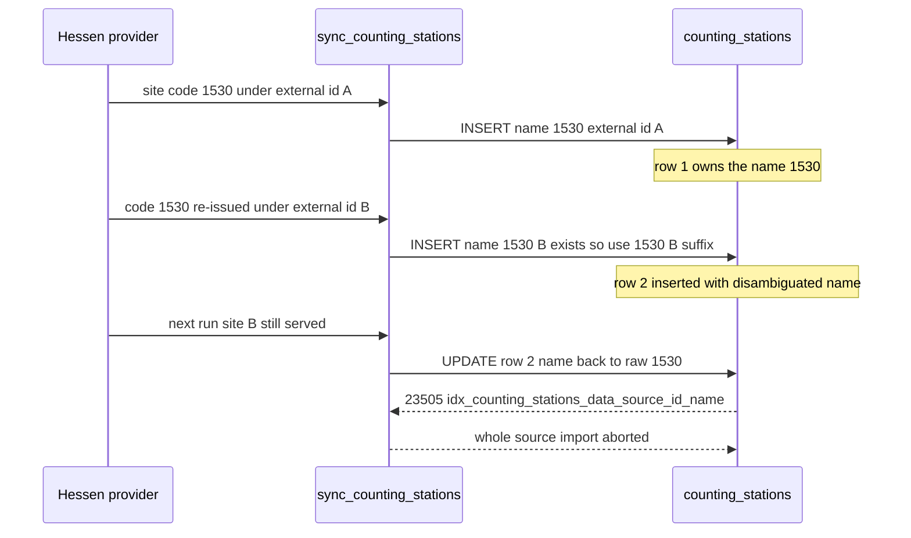

# 165 - Name collisions must never fail an import (drop station/channel name uniqueness)

Status: implemented

## Report (GitHub issue #47, image v0.0.9)

The Hessen data source failed on its **second** run (the first one succeeded,
37m 2s) after ~12 s with:

```
The last import failed: Database("duplicate key value violates unique constraint
\"idx_counting_stations_data_source_id_name\" (SQLSTATE 23505); constraint
'idx_counting_stations_data_source_id_name'; table 'counting_stations';
detail 'Key (data_source_id, name)=(2750a682-..., 1530) already exists.'")
```

State at the time: 557 stations / 557 channels, `Data imported until
26.10.26, 00:00`, last successful import `27.10.26, 19:54`, last import `Failed`
after 12 s with 0 added measurements.

This is the **second occurrence** of the same class: the first one was issue #37,
fixed by [`159_hessen_import_duplicate_key_plan.md`](plans/159_hessen_import_duplicate_key_plan.md:1).

## Root cause

Plan 159 added name arbitration only to the **insert** branch of
[`DataImportService::sync_counting_stations`](backend/src/core/application/data_import_service.rs:149):

- insert of a station whose external id is unknown → name is disambiguated against
  the persisted names of the source
  ([`unique_station_name`](backend/src/core/application/data_import_service.rs:136));
- **update** of a station matched by `external_datasource_id` → the provider's raw
  name is written unconditionally
  ([line 199](backend/src/core/application/data_import_service.rs:199) →
  [`update`](backend/src/core/application/data_import_service.rs:228)).

So the run that triggered plan 159 inserted `1530 (new-1530)` next to the older
row named `1530`, and the **next** run matched the new station by its external id
and wrote the raw name `1530` back onto it — while the older row still owned that
name for the same data source. Postgres rejected the `UPDATE` with `23505`.



Contributing causes:

1. **The arbitration only looked at inserts.** Nothing guarded the update path, so
   the disambiguated name was not sticky.
2. **The regression test could not catch it.** Plan 159's test
   ([`reuses_a_name_under_a_new_external_id_without_colliding`](backend/src/core/application/data_import_service.rs:1367))
   ran a *single* sync against an in-memory double that does **not** enforce the
   unique index — the second-sync failure mode was invisible by construction.
3. **Two more places rename names defensively**, each of them falsifying provider
   data:
   [`ensure_unique_names`](backend/src/adapter/driven/eco_counter/scraping/parsing.rs:335)
   (Hessen scraping, re-applied on every cached-index load) and
   [`unique_name`](backend/src/adapter/driven/muenster_github/parsing.rs:90)
   (Münster archive).
4. **The same gap exists for channels**: [`sync_channels`](backend/src/core/application/data_import_service.rs:346)
   writes `record.name` verbatim and can collide on
   `idx_channels_counting_station_id_name`.

## Decision (owner directive)

A station/channel **name is not an identity**. The identity is the row `id`
(UUID); the provider key is `external_datasource_id`, which is already globally
unique by
[`V2`](backend/migrations/V2__add_data_sources.sql:13). Duplicate display names are
legitimate data (Hessen publishes the same short code for two sites) and must
never abort an import, and the system must **not** invent suffixes.

Therefore the fix is to **remove the name-uniqueness requirement** instead of
arbitrating names more cleverly.

## Design

### 1. Database: drop the two name-unique indexes

New migration [`V28__drop_name_uniqueness.sql`](backend/migrations/V28__drop_name_uniqueness.sql:1)
(current head was [`V27`](backend/migrations/V27__add_import_run_facts.sql:1)):

- `DROP INDEX IF EXISTS idx_counting_stations_data_source_id_name;`
- `DROP INDEX IF EXISTS idx_channels_counting_station_id_name;`
- **both indexes are re-created non-unique** under the same names, so the lookups
  they served keep their plan (see
  [`92`](plans/92_data_source_detail_persisted_bounds_plan.md:40)) while
  duplicate names become legal;
- one-time repair of names the old code suffixed, matched **exactly** against the
  generated pattern so real provider names are untouched: a trailing
  `' (' || external_datasource_id || ')'` is stripped from
  `counting_stations` and `channels`. Rows whose external id is `NULL`, rows
  repaired by
  [`V8`](backend/migrations/V8__add_counting_station_and_channel_name_uniqueness.sql:12)
  with a UUID suffix, and the rare ` #<n>` fallback keep their name (all still
  valid now that names need not be unique).

The identity indexes stay untouched:
`idx_counting_stations_external_datasource_id`,
`idx_channels_external_datasource_id`,
`uq_*` opendata indexes and `measurements (channel_id, timestamp, resolution_seconds)`.

### 2. Core: provider names verbatim

In [`data_import_service.rs`](backend/src/core/application/data_import_service.rs:149):

- delete `unique_station_name` and the `used_names` seeding/query
  (`find_by_data_source_id` call at [line 170](backend/src/core/application/data_import_service.rs:170));
- insert **and** update use `record.name` unchanged;
- keep the rest of the update branch (rename propagation, reactivation, image sync)
  and the changed-attribute detection;
- drop the now-unused `HashSet` import if it becomes dead.

Result: `sync_counting_stations` becomes a plain idempotent reconciliation, and no
write in the import path can ever raise a naming collision.

### 3. Adapters: stop falsifying names

- Remove [`ensure_unique_names`](backend/src/adapter/driven/eco_counter/scraping/parsing.rs:335)
  and its call sites in the Hessen scraping parsing/adapter (cached-index load and
  the fresh crawl).
- Remove [`unique_name`](backend/src/adapter/driven/muenster_github/parsing.rs:90)
  and its use for station and channel names.
- Update the two adapter READMEs that document the naming invariant
  ([`eco_counter/scraping/README.md`](backend/src/adapter/driven/eco_counter/scraping/README.md:95),
  [`muenster_github/README.md`](backend/src/adapter/driven/muenster_github/README.md:84)).

### 4. Test infrastructure: make the bug reproducible

Plan 159 failed because its double was too permissive. Introduce **one** shared
in-memory `CountingStationRepository` / `ChannelRepository` test double that
enforces the identity invariants that really exist (`external_datasource_id`
uniqueness) and allows duplicate names, and use it for the import tests. New
regression tests:

1. two consecutive syncs where the provider re-issues a code under a new external
   id → second run succeeds and the names stay exactly what the provider sent;
2. two stations of the same source with the same name, and two channels of the
   same station with the same name, persist without error (Postgres repository
   test);
3. a provider renaming a station to a name another station of the source already
   uses → the rename is written as-is, no error.

### 5. Frontend: duplicate display names

React keys already use `station.id`
([`Sidebar.tsx`](frontend/src/features/sidebar/Sidebar.tsx:105),
[`SearchDialog.tsx`](frontend/src/features/search/SearchDialog.tsx:84),
[`DataSourceMap.tsx`](frontend/src/features/dataSources/DataSourceMap.tsx:58),
[`SummaryMap.tsx`](frontend/src/features/stationsSummary/SummaryMap.tsx:28)), so no
list/marker regression is expected. Two spots need attention:

- [`SharePie.tsx`](frontend/src/features/stationDetail/SharePie.tsx:57) uses
  `entry.name` as the React key / series name → make the key unique
  (`name` + index or channel id if available) and keep the legend readable when
  two series are named identically.
- the Playwright helper
  [`stationMarker`](frontend/e2e/helpers.ts:36) selects a marker by name and would
  hit strict-mode violations once two markers share a name → scope/`.first()`
  deterministically and keep the specs passing.

### 6. Documentation and fixtures

- `README.md` / adapter READMEs: names are display data, identity is `id`,
  `external_datasource_id` is the provider key.
- Regenerate [`frontend/e2e/e2e-seed.sql`](frontend/e2e/e2e-seed.sql:1) with
  [`scripts/dump-e2e-fixture.sh`](scripts/dump-e2e-fixture.sh:1) so the seeded
  `refinery_schema_history` matches the schema including `V28`. The regenerated
  fixture was verified twice: once by upgrading the old fixture through `V28` at
  backend startup, then by seeding the new fixture directly (`no migrations to
  apply`).

## Out of scope (follow-up candidates)

- Scoping the provider key to the data source
  (`UNIQUE (data_source_id, external_datasource_id)` instead of the current global
  index, and a data-source-scoped
  [`find_by_external_datasource_id`](backend/src/adapter/driven/postgres/counting_station_repository.rs:142))
  would let two providers use the same numeric ids. Recorded here; not required for
  this bug because the global index already prevents cross-source hijacking.
- Making a single failing station non-fatal for the whole source (skip + provider
  warning). With name collisions removed there is no known trigger left; revisit if
  another import-blocking class appears.

## Definition of done

- [x] `V28` migration drops both name-unique indexes, re-creates them non-unique and repairs auto-suffixed names
- [x] `sync_counting_stations` writes provider names verbatim on insert and update
- [x] `sync_channels` needs no change and is covered by a duplicate-name test
- [x] `ensure_unique_names` (Hessen) and `unique_name` (Münster) removed with their tests
- [x] Invariant-enforcing repository doubles (in-memory + Postgres) used by the import tests
- [x] Two-consecutive-syncs regression test reproduces the `1530` scenario and passes
- [x] Postgres repository tests allow duplicate station and channel names
- [x] `SharePie` keys are unique with duplicate names
- [x] Playwright marker helper tolerates duplicate station names
- [x] `frontend/e2e/e2e-seed.sql` regenerated
- [x] Adapter READMEs updated (`README.md` needed no change — it never documented the invariant)
- [x] `make check` green
- [x] `make test` green (840 tests)
- [x] `make coverage` green at or above the thresholds
- [x] `make test-playwright` green (76 tests)

## Verification notes

- The reported failure was reproduced as a test **before** the fix: the old
  double accepted everything, which is why plan 159 could not see the
  second-sync failure.
- The migrated dev database applies `V28` cleanly from `V27`
  (`DB-Migrations: drop_name_uniqueness ... done`) and the previously suffixed
  names are restored (e.g. `1530 (new-1530)` → `1530`).
- The two `make test-playwright` runs that failed during development failed at
  the backend healthcheck while the machine was building/loading; both passed
  once the build settled (`76 passed`, `e2e-playwright: OK`).
- Follow-up review findings:
  - Sonar flagged the empty-string guard as a `NULL` comparison; `V28` now uses
    `length(external_datasource_id) > 0`.
  - `V28` is idempotent (`DROP INDEX IF EXISTS` / `CREATE INDEX IF NOT EXISTS`),
    so the one-time repair can be re-applied while the PR is still open — the
    checksum was refreshed in the dev database and in the committed fixture.
  - Codecov patch coverage: the repository doubles' duplicate-provider-key guards
    are now covered by
    [`the_repository_double_rejects_a_duplicate_provider_key`](backend/src/core/application/data_import_service.rs:1566)
    and its channel counterpart, and the new tests avoid multi-line `assert!`
    message arguments (unexecuted on success), so the patch has no uncovered
    added lines.
