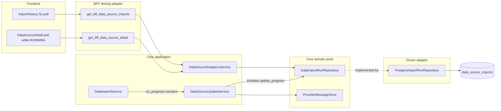
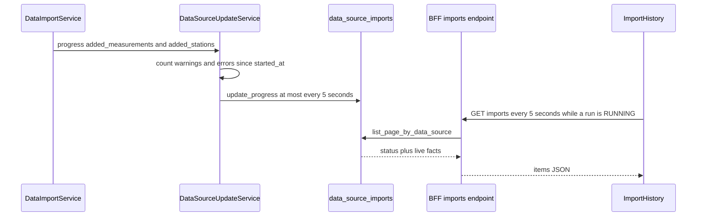

# 166 - Live import job status and counters in the Import jobs table

Status: implemented

## Problem

The per-source import run is inserted as `RUNNING` before the import starts, but
all four outcome counters are only persisted when the run finishes. The
**Import jobs** table on the data-source detail page therefore shows zeros for a
running import and has no status column at all: it renders a `Successful`
yes/no column instead.

Relevant code today:

- [`ImportHistory`](frontend/src/features/dataSources/ImportHistory.tsx:14) fetches
  one page once and renders `Successful`, `Warnings`, `Errors`,
  `New measurements` and `New stations`.
- [`BffDataSourceImportDto`](backend/src/adapter/driving/bff/dto.rs:813) already
  exposes `status` (`RUNNING` | `FINISHED` | `FAILED`) plus a redundant
  `successful` boolean.
- [`update_one_source`](backend/src/core/application/data_source_update_service.rs:380)
  records the `RUNNING` run, but writes the counters only through
  `finish_with_facts` / `fail_with_facts`.
- The `data_source_imports` table already has the counter columns
  ([`V27`](backend/migrations/V27__add_import_run_facts.sql:7)), so no schema
  change is needed.

## Goal

1. Work on a new branch `feature/import-jobs-live-status` and push it to
   `origin` when the change is ready.
2. Replace the **Successful** column with a **Status** column showing the
   canonical values `RUNNING`, `FINISHED` and `FAILED`; drop the `successful`
   field from the BFF DTO and the frontend type.
3. While a run is `RUNNING`, keep `warning_count`, `error_count`,
   `added_measurements` and `added_stations` up to date on the
   `data_source_imports` row so the table can display them before the run ends.
4. Poll the import-history endpoint while a visible run is `RUNNING` and stop
   polling when no run is running. Refresh the detail page's last-import cards
   the same way.
5. Keep the existing pagination, average-duration behaviour and all gates green.

## Architecture context

The backend follows a hexagonal ports-and-adapters layout. The core
([`backend/src/core`](backend/src/core/mod.rs:1)) owns the domain model and the
traits; it never references an adapter. Driving adapters call the core, driven
adapters implement the core ports, and [`main.rs`](backend/src/main.rs:1) is the
only composition root that wires the two sides together.

```mermaid
flowchart TB
    subgraph Inbound[Driving adapters - inbound]
        FE[React frontend]
        REST[REST API /api/v1]
        BFF[BFF API /api/bff]
        SCHED[Cron job scheduler]
    end

    subgraph Core[Core - domain and application]
        subgraph Application[Application services]
            DAS[DataSourceAnalyticsService]
            DUS[DataSourceUpdateService]
            DIS[DataImportService]
            OTHER[Other use-case services]
        end
        subgraph Domain[Domain model and ports]
            MODEL[Aggregates and value objects]
            PORT_PROVIDER[DataProvider]
            PORT_RUN[DataImportRunRepository]
            PORT_MSG[ProviderMessageStore]
            PORT_JOB[JobRepository]
            PORT_DS[DataSourceRepository]
            PORT_CFG[ConfigurationRepository]
            PORT_ASSET[AssetStorage]
            PORT_TILES[TilesProvisioning]
            PORT_ODATA[OpenDataFileGenerator]
        end
    end

    subgraph Outbound[Driven adapters - outbound]
        PG[Postgres repositories]
        CFG[TOML configuration adapter]
        PROVIDERS[Provider adapters: Muenster Bonn Hamburg Leipzig EcoCounter Hessen]
        STORAGE[S3 Garage asset storage]
        TILES[Tiles init]
        ODATA[OpenData file generator adapter]
    end

    FE --> BFF
    REST --> OTHER
    BFF --> DAS
    BFF --> OTHER
    SCHED --> DUS

    DAS --> PORT_RUN
    DAS --> PORT_MSG
    DUS --> DIS
    DUS --> PORT_RUN
    DUS --> PORT_JOB
    DIS --> PORT_PROVIDER
    DIS --> PORT_DS
    OTHER --> MODEL

    PG -. implements .-> PORT_RUN
    PG -. implements .-> PORT_MSG
    PG -. implements .-> PORT_JOB
    PG -. implements .-> PORT_DS
    CFG -. implements .-> PORT_CFG
    PROVIDERS -. implements .-> PORT_PROVIDER
    STORAGE -. implements .-> PORT_ASSET
    TILES -. implements .-> PORT_TILES
    ODATA -. implements .-> PORT_ODATA
```



Consequences for this change:

| Layer | Location | Responsibility in this feature |
|---|---|---|
| Driving adapter | [`bff/handlers.rs`](backend/src/adapter/driving/bff/handlers.rs:1257) | Maps domain runs to JSON DTOs; removes `successful`; stays free of SQL and business rules |
| Driving adapter | [`bff/dto.rs`](backend/src/adapter/driving/bff/dto.rs:813) | Wire schema with `status` and the four counters |
| Application | [`data_source_analytics_service.rs`](backend/src/core/application/data_source_analytics_service.rs:163) | Reads the paginated run history through the port |
| Application | [`data_source_update_service.rs`](backend/src/core/application/data_source_update_service.rs:380) | Owns the live-progress orchestration and throttling |
| Application | [`data_import_service.rs`](backend/src/core/application/data_import_service.rs:415) | Reports counter progress through a callback, independent of persistence |
| Domain port | [`import_run_port.rs`](backend/src/core/domain/data_source/import_run_port.rs:14) | Declares `update_progress`; test doubles use the default no-op |
| Driven adapter | [`postgres/import_run_repository.rs`](backend/src/adapter/driven/postgres/import_run_repository.rs:50) | Implements `update_progress` against `data_source_imports` |

The feature-specific flow stays inside those boundaries:



## Design

Live counters are written by the import worker itself, not derived in the BFF:

- [`DataImportService`](backend/src/core/application/data_import_service.rs:415)
  gains an additive progress callback that reports the counters it knows
  (`added_stations` after the station sync, `added_measurements` after every
  batch). The existing `update_data_source_with_progress` keeps its signature and
  delegates with a no-op callback.
- [`DataSourceUpdateService`](backend/src/core/application/data_source_update_service.rs:380)
  uses the new callback, adds the `warning_count` / `error_count` from the
  provider-message store since `started_at`, and calls
  `DataImportRunRepository::update_progress`. Writes are throttled to at most one
  per 5 seconds, matching the frontend poll interval. Bookkeeping failures are
  logged, never fatal.
- The final `finish_with_facts` / `fail_with_facts` still writes the exact
  snapshot, so the finished row is unchanged.



## API contract

No new endpoint and no new field: `status` and the four counters already exist.
Remove the redundant `successful` field from `BffDataSourceImportDto`:

```json
{
  "status": "RUNNING",
  "started_at": "2026-10-29T18:00:00Z",
  "finished_at": null,
  "duration_seconds": null,
  "failure_message": null,
  "warning_count": 3,
  "error_count": 1,
  "added_measurements": 1200,
  "added_stations": 2
}
```

## Implementation tasks

### Task 0 - Branch

- Create and switch to `feature/import-jobs-live-status`.
- Push the branch to `origin` after the gates are green.

### Task 1 - Repository live progress

- Add `update_progress(&self, id: Uuid, facts: ImportRunFacts)` to
  [`DataImportRunRepository`](backend/src/core/domain/data_source/import_run_port.rs:14)
  with a default `Ok(())` so in-memory test doubles keep compiling.
- Implement it in
  [`PostgresImportRunRepository`](backend/src/adapter/driven/postgres/import_run_repository.rs:50)
  as an `UPDATE data_source_imports SET added_measurements = …, added_stations = …,
  warning_count = …, error_count = … WHERE id = $1 AND status = 'RUNNING'`.
  A non-RUNNING row is a no-op (`Ok(())`) because progress is best effort.
- Add Postgres repository tests: progress updates a RUNNING row, and progress
  after the run finished does not overwrite the final facts.

### Task 2 - Core live progress reporting

- Add
  [`DataSourceImportProgress`](backend/src/core/application/data_import_service.rs:37)
  with `added_measurements` and `added_stations`.
- Add
  [`update_data_source_with_live_progress`](backend/src/core/application/data_import_service.rs:415)
  taking an extra `on_progress` callback. Invoke it after the station sync and
  after every saved batch. Keep `update_data_source_with_progress` delegating
  with a no-op callback; it is now test-only (`#[cfg(test)]`) because production
  uses the live variant.
- Extend
  [`update_one_source`](backend/src/core/application/data_source_update_service.rs:380)
  to call the live variant:
  - use a local `std::time::Instant` to write progress at most once per 5
    seconds, starting with the first report after the station sync;
  - count WARNING/ERROR provider messages since `started_at` when writing, same
    as the final snapshot;
  - call `import_run_repository.update_progress` in a best-effort `if let Err`
    that logs through `tracing::error!`.
- Extend the in-memory test repository in the update-service tests to record
  progress calls, and assert that a running import reports `added_stations`,
  live `added_measurements` and the warning/error counts, with the final
  `finish_with_facts` snapshot still authoritative.
- Add a `DataImportService` unit test that the new progress callback reports the
  station count and each batch's measurement count.

### Task 3 - BFF DTO cleanup

- Remove `successful` from
  [`BffDataSourceImportDto`](backend/src/adapter/driving/bff/dto.rs:813) and
  [`import_run_dto`](backend/src/adapter/driving/bff/handlers.rs:1257).
- Update the BFF REST tests in
  [`bff.rs`](backend/src/adapter/driving/rest/tests/bff.rs:1451) that assert
  `successful`; keep asserting the canonical `status` values.
- Confirm the OpenAPI schema still documents `status` and the four counters.

### Task 4 - Frontend live table and polling

- Remove `successful` from
  [`DataSourceImport`](frontend/src/features/dataSources/types.ts:26).
- In [`ImportHistory`](frontend/src/features/dataSources/ImportHistory.tsx:14):
  - replace the **Successful** header with **Status**;
  - render `RUNNING`, `FINISHED` or `FAILED` (badge with the existing
    destructive/secondary/outline variants);
  - show the live elapsed time in the Duration cell for a `RUNNING` row using
    [`RunningDuration`](frontend/src/features/dataSources/ImportStatus.tsx:17);
  - poll `fetchDataSourceImports(dataSourceId, offset, IMPORT_PAGE_SIZE)` every
    5 seconds while any visible item has `status === 'RUNNING'`;
  - polling must not clear the table or flash the skeleton/error state; stop the
    interval when no running row remains.
- Rename the finished badge label in
  [`ImportStatus`](frontend/src/features/dataSources/ImportStatus.tsx:31) from
  `Succeeded` to `Finished` so the vocabulary matches the new status column.
- In [`DataSourceDetail`](frontend/src/features/dataSources/DataSourceDetail.tsx:52),
  poll `fetchDataSourceDetail` every 5 seconds while
  `detail.last_import.status === 'RUNNING'` so the last-import cards
  (status, duration, warnings, errors) stay in sync.
- Update the unit tests and fixtures:
  - `ImportHistory.test.tsx`: status headers/values, no `Successful`, a
    RUNNING -> FINISHED polling test with fake timers (assert the second request
    and the updated counters), and polling stops afterwards;
  - `ImportStatus.test.tsx`, `DataSourceDetail.test.tsx`,
    `DataSourcesList.test.tsx`: drop `successful`, expect `Finished`;
  - add a detail-page polling test if practical.

### Task 5 - Docs, e2e and gates

- Update the README's BFF paragraph
  ([`README.md`](README.md:172)) to mention the live status/counters while an
  import runs.
- The existing Playwright specs use finished seeded runs and must stay green;
  no new fixture is needed because polling only starts for `RUNNING` rows.
- Extend the Playwright data-source spec to assert the new **Status** column
  renders `FINISHED`/`FAILED` instead of the removed `Successful` column.
- Run: `make check`, `make test-rest`, `make test`, `make test-unit`,
  `make coverage` and `make test-playwright`.
- Push the branch and tick every item below; set this plan's status to
  `implemented` when done.

## Gate results

- `make check` — passed (`cargo fmt --check`, `clippy -D warnings`, Prettier and
  `cargo audit`; only the pre-existing allowed `yoke-derive` yank warning).
- `make test-rest` — 132 passed.
- `make test` — 849 passed (includes the new Postgres live-progress test).
- `make test-unit` — 91 files / 580 tests passed.
- `make coverage` — backend and frontend thresholds passed.
- `make test-playwright` — 76 passed. The first run had one unrelated flaky
  map-popup navigation failure; the immediate rerun was 76/76 green. The flake
  itself is fixed in [plan 167](167_playwright_map_popup_settle_plan.md).

## Addendum - Codecov patch coverage

The Codecov review of the first push flagged a few changed lines without
coverage. Added tests for:

- the default no-op `DataImportRunRepository::update_progress`
  ([`import_run_port.rs`](backend/src/core/domain/data_source/import_run_port.rs:22));
- the live-progress failure branches in `record_live_progress` — provider
  message count failure, progress write failure and the throttle window
  ([`data_source_update_service.rs`](backend/src/core/application/data_source_update_service.rs:385));
- the `DataSourceDetail` polling callback
  ([`DataSourceDetail.test.tsx`](frontend/src/features/dataSources/DataSourceDetail.test.tsx));
- the `ImportHistory` "Unknown" duration and the poll response that arrives
  after unmount ([`ImportHistory.test.tsx`](frontend/src/features/dataSources/ImportHistory.test.tsx)).

Follow-up gate results: `make check` green, backend tests 853 passed,
frontend 91 files / 584 tests passed, `make coverage` green, and two consecutive
Playwright runs passed 76/76.

## Out of scope

- WebSocket/SSE streaming; polling is sufficient for this UI.
- A new generic jobs page or changes to `/api/v1/jobs`.
- Changing the definition of the average import duration.

## Definition of done

- [x] Branch `feature/import-jobs-live-status` created and pushed to `origin`
- [x] `data_source_imports` counters are persisted while a run is `RUNNING`
- [x] Import jobs table shows a Status column with `RUNNING`, `FINISHED` and
      `FAILED`, and no longer shows `Successful`
- [x] Warnings, Errors, New measurements and New stations update live while the
      job runs
- [x] Polling starts only while a run is running and stops when it finishes
- [x] `successful` is removed from the BFF DTO and the frontend type
- [x] Backend, frontend unit and Playwright tests cover the new behaviour
- [x] `make check`, `make test`, `make coverage` and `make test-playwright` green
- [x] Playwright asserts the new Status column
- [x] README and this plan updated, all boxes ticked
